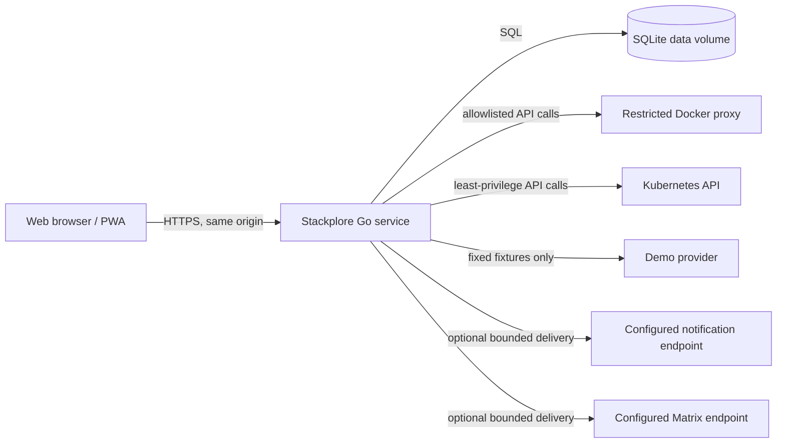

# Stackplore Architecture

Status: Target architecture with Phase 4 domain and contract foundation
Last updated: 2026-08-01

This document defines the intended v1 architecture for Stackplore. Phase 0
established the design and governance documents. Phases 1 through 4 implement
the developer scaffold, responsive and bilingual interface foundation,
provider-neutral domain contracts, focused read ports, and an empty versioned
API schema foundation. Product service runtime, provider behavior, storage, and
deployment behavior described here remain targets for later phases, not claims
about current functionality.

## Goals and constraints

Stackplore is a self-hosted, single-installation infrastructure explorer for
Docker and Kubernetes. The architecture must:

- normalize discovery, health, topology, logs, metrics, and events without
  leaking provider credentials or secret values to the browser;
- be read-only unless an operator deliberately enables a small allowlist of
  guarded actions;
- support deterministic demonstration data without contacting real
  infrastructure;
- deliver a responsive React application and a versioned Go API from one
  origin in production;
- operate as one active API instance in v1 because SQLite is the system of
  record;
- preserve clear domain and repository ports so another database can be added
  later;
- bound memory, storage, concurrency, and stream lifetimes;
- remain portable to a future desktop wrapper by keeping provider access on the
  server and platform concerns outside frontend domain features.

## Architecture principles

1. **Dependencies point inward.** HTTP, databases, and provider clients adapt
   to application and domain ports. Domain packages do not import transport or
   vendor packages.
2. **The server owns trust.** Authentication, authorization, credential
   references, metadata filtering, redaction, and mutation policy are enforced
   by the Go service. Browser state is never a security boundary.
3. **Normalize evidence, preserve provenance.** Common models make providers
   comparable, while typed safe metadata and relationship evidence preserve
   provider detail.
4. **Read paths and command paths are separate.** Discovery and observation
   ports cannot perform infrastructure changes. A narrow command port exists
   only for explicitly supported actions.
5. **Limits are part of every contract.** Page size, lookback, line count,
   sample retention, queue depth, request duration, and concurrent streams have
   server-enforced ceilings.
6. **Degraded is a valid state.** Missing permissions or optional metrics
   services produce explicit partial results, not fabricated data or broad
   failure.
7. **One contract owns HTTP shape.** `contracts/openapi.yaml` is the OpenAPI 3.1
   source for `/api/v1`; the TypeScript client is derived reproducibly from that
   contract.

## System context



The browser communicates only with Stackplore. It never receives Docker
credentials, kubeconfig content, private keys, raw session tokens from storage,
or Secret values. Docker and Kubernetes remain separate trust boundaries with
their own least-privilege deployment profiles.

## Repository boundaries

The target repository is a single source tree with these primary ownership
areas:

```text
apps/
  api/                 Go service, domain, ports, adapters, migrations
  web/                 React, strict TypeScript, and Vite application
packages/
  api-client/          contract-derived browser client and fetch policy
  ui/                  shared accessible presentation primitives
contracts/
  openapi.yaml         OpenAPI 3.1 source of truth
deploy/
  compose/             container deployment and restricted Docker profile
  helm/stackplore/     Kubernetes deployment and least-privilege RBAC
docs/
  adr/                 architecture decisions
```

The pnpm workspace coordinates JavaScript packages and repository commands.
The Go service remains an explicit Go module within the same repository. Exact
dependency versions belong in lockfiles and module files.

## Runtime building blocks

| Building block | Responsibility | Must not do |
| --- | --- | --- |
| React web application | Navigation, accessible presentation, local interaction, localization, and API consumption | Contact providers, hold provider credentials, or decide authorization |
| Chi HTTP adapter | Routing, decoding, validation handoff, auth middleware, limits, response encoding, and SSE framing | Contain domain rules or provider-specific inference |
| Application services | Coordinate use cases, transactions, permissions, capabilities, and audit outcomes | Depend on HTTP or concrete storage |
| Domain model | Provider-neutral resources, relationships, health, metrics, events, alerts, and action policy | Import vendor clients or expose unsafe metadata |
| Provider adapters | Translate Demo, Docker, and Kubernetes behavior into domain ports | Return credentials, Secret values, or unbounded payloads |
| Repository adapters | Implement persistence ports, migrations, retention, and transaction boundaries | Leak SQL types into domain services |
| Realtime hub | Fan out authorized live events with replay and bounded queues | Become the durable source of record |
| Background services | Discovery refresh, sampling, event watches, alert evaluation, pruning, and notification delivery | Outlive shutdown context or run without concurrency bounds |

### Backend dependency direction

```text
cmd/server
  -> configuration and composition root
  -> HTTP and background adapters
  -> application services
  -> domain types and ports

provider adapters  -----> domain provider ports
SQLite adapter     -----> domain repository ports
HTTP adapter       -----> application use cases
```

Explicit constructors form the composition root. Process-wide mutable
singletons are avoided. Every provider call, database call, request, watch, and
background loop receives a cancellation context.

### Frontend dependency direction

```text
routes
  -> feature modules
  -> shared UI and browser services
  -> typed API client

typed API client -> /api/v1 only
```

TanStack Query owns server state. URL parameters own shareable filters. Local
component state owns local interaction. A small cross-cutting UI store may be
introduced only when real state cannot fit those three places. Provider
conditionals belong in typed capabilities and presentation adapters, not in
route-level data access.

### Contract boundary

`contracts/openapi.yaml` is the canonical OpenAPI 3.1 transport document.
Phase 4 establishes shared schemas under the `/api/v1` server prefix while
keeping `paths` empty until real handlers exist. This separates schema
foundation from runtime endpoint claims.

The contract derivation tool writes browser transport types into one committed
file under `packages/api-client/src/derived`. Handwritten modules in that package
own same-origin request construction, safe problem parsing, and request-ID
capture. Application features import the package boundary rather than derived
files directly.

Go domain types and provider ports are not derived from OpenAPI. They remain
independent from HTTP and provider SDKs; future HTTP adapters explicitly map
between domain and transport types. Repository checks lint contract policy and
fail when committed browser types are stale.

### Localization and direction

The web application owns one locale provider for `en` and `fa`. Paired,
feature-owned catalogs hold production copy, while a repository check enforces
key, message-kind, plural-form, and placeholder parity. Components consume
typed keys instead of hardcoded visible copy.

The browser stores the initial preference under `stackplore.locale`. A small
head script applies language and direction before paint; the runtime provider
then owns live updates and feeds the same direction into shared interface
primitives. Phase 24 may hydrate an authenticated user preference through this
provider without changing the rendering boundary.

English presentation uses `en-US`. Persian presentation uses
`fa-IR-u-ca-persian-nu-arabext`, including the Persian calendar and native
digits. Domain and API time values remain canonical UTC. Resource identifiers,
image names, addresses, and other technical values are never translated or
number-shaped and render in an isolated left-to-right element.

## HTTP and delivery model

Production uses one origin:

- the Go service serves the built web assets;
- API routes live below `/api/v1`;
- operational endpoints include `/healthz`, `/readyz`, and `/metrics`;
- the SPA fallback applies only to browser routes and never masks API or
  operational 404 responses;
- hashed public assets may be cached immutably, while HTML uses revalidation;
- API, authentication, logs, metrics, and SSE responses are never stored by the
  PWA cache.

Cacheable application-shell HTML uses a static hash-based content policy.
Nonce-bearing or personalized HTML is `no-store`, network-only, and never
enters the service-worker cache.

During development, Vite proxies API and stream requests to the Go service so
cookie and same-origin behavior match production. General CORS support is not a
default feature. If a future deployment needs another origin, it requires a
separate security decision.

HTTP handlers use consistent problem responses, request IDs, input limits,
pagination, filtering, documented status codes, and safe error messages. The
OpenAPI contract is changed before or with handler changes. Contract checks
prevent undocumented routes and stale browser types. Phase 4 defines no
`/api/v1` operation; Phase 5 and later handler phases add paths with runtime
behavior and tests.

## Core domain model

The stable model includes:

- `User` and `Session`;
- `InfrastructureSource` and `Environment`;
- `Scope`, `Resource`, and `ResourceSnapshot`;
- `Relationship` with direction, provenance, confidence, and safe metadata;
- `HealthSnapshot` and `MetricSample`;
- `InfrastructureEvent`;
- `AlertRule`, `Alert`, and `NotificationDelivery`;
- `AuditEntry`.

Phase 4 implements the provider-neutral resource, relationship, health, metric,
event, alert, audit, capability, query, and provider-status parts under
`apps/api/internal/domain`. Versioned composite digests provide stable resource
and relationship identifiers. Validation bounds identifiers, display text,
queries, result sets, evidence, and live-read targets, and requires canonical
UTC timestamps. User, session, notification-delivery, storage, and HTTP service
behavior remain owned by later phases.

Resource identity is a stable composite of provider kind, source identifier,
environment scope, resource kind, namespace or project, and provider-native
identifier. Display names are not identity. DTOs expose provider-neutral fields
plus small typed metadata blocks whose fields are explicitly reviewed for safe
display.

Resource health uses a common state set: healthy, degraded, unhealthy, and
unknown. Adapters preserve the evidence used to reach a state. Availability is
a separate outcome: available, stale, unavailable, unsupported, or permission
denied. Missing evidence never maps to healthy.

Relationships are evidence records, not just graph edges. Each edge carries:

- source and target stable identifiers;
- relationship type and direction;
- provider and source identifier;
- provenance, such as ownership, selector, route, annotation, declared
  dependency, storage reference, or network membership;
- confidence appropriate to that evidence;
- bounded, safe metadata.

Shared network membership is never presented as proven application dependency.
Duplicate evidence is coalesced without discarding provenance.

## Provider architecture

Providers implement focused ports rather than one large interface:

- inventory and detail discovery;
- health snapshots;
- topology evidence;
- bounded log reads and live tails;
- current metric samples;
- event history and live watches;
- capability inspection.

Application services persist bounded samples and query historical metrics
through repositories. Provider adapters do not fabricate stored history.

The optional infrastructure command port is separate. Application services
select a provider by source identifier and ask for capabilities before invoking
an operation. Unsupported and permission-denied outcomes are typed states.

Adapters translate at the boundary:

- the Demo adapter reads versioned deterministic fixtures;
- the Docker adapter uses `github.com/moby/moby/client`;
- the Kubernetes adapter uses official `client-go` packages and GA API versions
  where available. The optional read-only Resource Metrics API is the narrow
  named `metrics.k8s.io/v1beta1` exception until that upstream API offers a GA
  version.

Provider-specific objects do not pass through the application service layer.
Docker labels and Kubernetes metadata are filtered by explicit field rules.
Adapters may receive raw provider payloads that contain sensitive fields; they
drop those fields before the application boundary and never persist, log, or
return them. Environment-variable values are not sought for inference.
Kubernetes Secret objects are never requested. Secret references are learned
only from safe workload specifications.

Provider watches reconnect with bounded backoff and jitter, respect
cancellation, and surface stale or disconnected status. Discovery refreshes use
bounded concurrency per source so a slow control plane cannot exhaust the
server.

## Storage architecture

SQLite is the v1 system of record. The intended driver candidate is
`modernc.org/sqlite`, subject to compatibility confirmation in the storage
phase. V1 runs exactly one active API instance against a data file. Multiple
replicas and network filesystem sharing are unsupported.

Storage behavior includes:

- embedded, ordered, forward schema migrations before readiness;
- foreign keys enabled for every connection;
- WAL mode and a bounded busy timeout;
- short write transactions and a controlled writer path;
- repository interfaces at domain boundaries;
- retention and batch pruning for samples, events, sessions, and deliveries;
- a separate audit quota, minimum retention, bounded pruning worker, and
  cutoff-and-count summary record;
- bounded query ranges and indexed access paths;
- consistent UTC timestamps with locale formatting confined to presentation;
- documented, tested backup and restore procedures before release.

Raw passwords and raw session tokens are never stored. Connection records
prefer mounted file paths or environment references over credential material.
Provider keys, kubeconfig content, Secret values, and complete environment
dumps do not belong in SQLite.

Repository ports express domain operations and transaction needs, not SQL
queries. This leaves room for a future PostgreSQL adapter without changing
domain services or HTTP contracts.

## Authentication and request security

V1 uses local users, Argon2id password hashing, and opaque server-side sessions.
The browser receives only a secure session cookie. The database stores a
one-way token digest and session metadata. Login rotates the session, logout
revokes it, expiration is enforced server-side, and administrators can revoke
sessions. Every authorized request resolves the current user enabled state and
role; password, role, enabled-state, and recovery changes revoke that user's
sessions.

Authenticated state-changing requests require all of:

- an authenticated, unexpired session;
- the required role;
- a synchronizer CSRF token in a custom header;
- same-origin validation;
- route-specific input validation.

Login and first-run setup have no session yet. An auth preflight issues a
bounded, short-lived server nonce, an HttpOnly SameSite pre-auth cookie, and a
separate bound header token. Login or setup requires that cookie, token, and a
valid `Origin`, then consumes the nonce.

Cookie policy uses HttpOnly, SameSite, path `/api/v1`, and Secure under HTTPS.
Login and setup endpoints have request and account-aware rate limits. The first
administrator is created through a transaction that succeeds only while no
user exists. Setup then closes permanently. When a deployment is reachable
beyond loopback, setup also requires a short-lived, one-use bootstrap proof
configured through an operator-controlled out-of-band channel. The proof is
compared safely and never enters persistent storage, logs, errors, or audit
metadata. The last enabled administrator cannot be disabled, deleted, or
demoted. Local operator recovery never reopens network setup.

A non-loopback production profile requires an HTTPS configured public origin
and accepts forwarding headers only from explicit trusted proxy addresses.

Production requires authentication. A guest demo view may exist only under an
explicit demo-deployment setting; that setting also prevents real provider
configuration and every infrastructure mutation.

Administrator and viewer roles are installation-wide in v1. A viewer can see
all normalized provider data from every configured source. Authentication,
account, configuration, and full audit data remain administrator-only; v1 does
not provide source-level or tenant isolation.

See [ADR-0005](adr/0005-local-sessions-and-csrf.md) and the
[security model](security.md).

## Realtime architecture

Server-sent events carry resource status, events, metrics, log tails, and alert
updates. SSE matches the predominantly server-to-browser flow and works with
same-origin session cookies.

Each stream has:

- authorization and scope checks before subscription;
- typed event names and schema-versioned JSON payloads;
- monotonically ordered event IDs within its replay scope;
- keepalive comments;
- a bounded replay ring;
- a bounded per-client queue;
- maximum clients per user and per server;
- cancellation on disconnect, logout, source removal, or shutdown.

Clients reconnect with `Last-Event-ID`. If the requested position is outside
the replay window or a process restart invalidates it, the server sends an
explicit reset instruction and the client refreshes the relevant snapshot.
When a client cannot keep up, the server closes that stream with a recoverable
reason instead of growing memory or silently serving stale state.

The realtime hub is transient. Durable infrastructure events, metric samples,
alerts, and audit entries use repositories where retention policy requires
history.

See [ADR-0004](adr/0004-server-sent-events.md).

## Read-only policy and guarded actions

Observation is always available independently of infrastructure mutation.
Action routes are narrow, typed use cases, never general Docker, Kubernetes, or
shell proxies.

An action proceeds only when every gate passes:

1. `STACKPLORE_MUTATIONS_ENABLED=true` was set when the service started.
2. The deployment profile grants the exact provider write permission.
3. The authenticated user is currently enabled and is an administrator.
4. CSRF, same-origin, and recent-authentication checks pass.
5. The runtime is not in demo deployment mode and the target is not synthetic.
6. The source reports the exact action capability.
7. The target kind and action are on the v1 allowlist, and the expected current
   version still matches.
8. The user submits a short-lived, single-use confirmation bound to actor,
   source, target, action, and material parameters.
9. An idempotency record prevents a retry from duplicating an accepted effect.
10. Audit intent commits durably; an audit-write failure stops the action.
11. A server timeout and provider-specific least-privilege check apply.
12. The final outcome, including an uncertain timeout, is recorded with a
    request ID and safe metadata.

V1 permits only Docker container restart, supported Kubernetes workload
restart, and scaling of supported Kubernetes workload kinds. Delete, exec,
shell, arbitrary API proxying, secret editing, image deployment, and cluster
administration have no command path.

Deployment permissions are split into read-only and optional mutation profiles.
The user interface renders action state from server-returned capabilities but
does not enforce the policy.

See [ADR-0006](adr/0006-read-only-and-guarded-mutations.md).

## Deterministic demo isolation

The demo provider supplies versioned fixtures with stable identifiers, ordered
events, a controlled clock, and fixed metric and log sequences. It performs no
provider network access and implements no infrastructure command port. Every
demo resource and response is marked synthetic.

Demo deployment mode composes only the demo adapter. It rejects real source
configuration, disables outbound notification delivery, and keeps all
infrastructure actions unavailable. This makes public demonstration deployments
safe and keeps screenshots and tests repeatable.

Guest demo deployment uses a separate data root and database carrying the
fixture-version marker. Startup rejects non-demo source or history rows and
never accepts a normal installation database. The scenario resets to its
versioned initial step at process start and on explicit reset; a fixture upgrade
clears prior demo-derived history before serving the new version.

See [ADR-0007](adr/0007-deterministic-isolated-demo.md).

## Background work and consistency

Long-running work is owned by a supervisor tied to the process shutdown
context. Each loop has a clear cadence, timeout, concurrency ceiling, and
bounded retry policy. Sources have independent health so one unavailable
provider does not stop unrelated reads.

SQLite writes from discovery, metrics, alerts, and audit activity pass through
short, deliberate transaction boundaries. Work that can be reconstructed, such
as the live replay ring, stays in memory. State that must survive restart is
committed before a success response or notification acknowledgement.

Notification delivery uses an outbox-style persisted record so process failure
does not lose an accepted delivery. Retries are capped, observable, and safe to
attempt, but delivery semantics are at-least-once. Every retry keeps one stable
delivery identifier and identical canonical payload bytes. Webhooks carry that
identifier as an idempotency key and signed field; Matrix uses it as the
transaction identifier. A timeout remains uncertain rather than being called a
failure or safe non-delivery.

Webhook and Matrix calls share scheme, DNS, resolved-address, redirect,
body-size, and timeout controls. Full webhook URLs, Matrix tokens, and signing
keys come from operator-created secret references and never enter browser
responses, logs, audit details, diagnostics, or configuration exports.
Matrix homeserver discovery is disabled in v1. Its operator-mapped token is
sent only to the exact configured canonical HTTPS origin and never follows a
redirect.

## Operational behavior

The Go service uses `log/slog` with structured fields and a centralized
redaction policy. Logs include request IDs and stable safe resource
identifiers, but exclude session material, passwords, provider credentials,
kubeconfig content, private keys, Secret values, and unfiltered payloads.

Operational endpoints have distinct meaning:

- `/healthz` reports terse process liveness;
- `/readyz` reports terse local readiness;
- `/metrics` is disabled for untrusted clients by default and requires an
  internal edge allowlist or operational authentication.

Authenticated administrators can inspect detailed readiness at
`/api/v1/system/readiness`, which is covered by the `/api/v1` cookie path.
Metrics use low-cardinality labels and never label by user, source,
provider-native identifier, resource name, or log-derived value.

Provider availability belongs in product status APIs and does not normally make
the process unready. SIGTERM stops new work, closes streams, cancels watches,
drains bounded in-flight requests, closes repositories, and exits within the
configured grace period.

## Deployment model

The production image is intended to:

- build the web application and Go service in separate stages;
- contain the web assets in the final non-root runtime;
- use a read-only root filesystem where practical;
- persist the SQLite database and runtime data in one mounted volume;
- expose one HTTP port;
- include health checks and graceful termination.

Compose drops all Linux capabilities, enables no-new-privileges, uses the
runtime default seccomp profile, and mounts only reviewed writable data or
temporary paths. Kubernetes uses `runAsNonRoot`, disallows privilege
escalation, drops all capabilities, selects `RuntimeDefault` seccomp, and keeps
the root filesystem read-only. Service-account token automount is off unless
the explicit in-cluster provider profile needs its dedicated identity.

Non-loopback production requires an HTTPS public origin at a trusted edge. The
recommended Docker profile places a restricted authorization proxy between
Stackplore and Docker. Direct socket mounting is for loopback development only
and is documented as high risk. An operator-mapped remote Docker endpoint
requires verified mutual TLS and an equivalent daemon-side allowlist.

Kubernetes deployment defaults to namespace-scoped read-only RBAC. An explicit
cluster-observation profile adds only the cluster-scoped read rights needed for
nodes and namespaces. Mutation RBAC remains separate, and no profile requires
cluster-administrator access or Secret read permission.

The release deployment runs exactly one API process. Kubernetes uses one
replica with a `Recreate` update strategy, and process startup acquires an
exclusive database ownership lock before migrations or background work.
Backup uses a local operator-only SQLite online-backup command; restore is
offline and revokes restored sessions.

## Scaling and availability limits

V1 deliberately favors a small, understandable deployment:

- exactly one active API process;
- no cross-process SSE fan-out;
- no active-active database access;
- bounded local metric and event history;
- no multi-tenant isolation guarantee.

Vertical resource limits, query bounds, retention, provider polling cadence,
and stream caps protect that process. High availability requires a later
decision covering PostgreSQL, distributed coordination, shared stream
transport, migration ownership, and session behavior.

## Verification expectations

Later phases must prove the design with:

- domain tests against fake ports;
- repository contract and migration tests;
- provider fixture tests plus clearly labeled optional live checks;
- auth, role, CSRF, rate-limit, redaction, and action-gate tests;
- SSE replay, overflow, cancellation, and reconnect tests;
- OpenAPI validation and browser-client compatibility checks;
- English, Persian, RTL, accessibility, and browser journey tests;
- container, Compose, and Helm validation where those runtimes are available.

Missing host tools or infrastructure must be reported as a verification gap.
Documentation must not turn a mocked result into a live integration claim.

## Recorded decisions

The decision log is indexed in [`docs/adr/README.md`](adr/README.md).

| Decision | Summary |
| --- | --- |
| [ADR-0001](adr/0001-monorepo-and-same-origin.md) | One repository and one production origin |
| [ADR-0002](adr/0002-provider-neutral-boundary.md) | Provider-neutral domain ports and safe metadata |
| [ADR-0003](adr/0003-sqlite-single-instance-and-repositories.md) | SQLite, one active API instance, and repository ports |
| [ADR-0004](adr/0004-server-sent-events.md) | SSE for bounded server-to-browser live streams |
| [ADR-0005](adr/0005-local-sessions-and-csrf.md) | Local server-side sessions and CSRF defense |
| [ADR-0006](adr/0006-read-only-and-guarded-mutations.md) | Read-only default with narrow guarded actions |
| [ADR-0007](adr/0007-deterministic-isolated-demo.md) | Deterministic demo fixtures in an isolated mode |
| [ADR-0008](adr/0008-project-owned-interface-system.md) | Project-owned interface primitives and themes |
| [ADR-0009](adr/0009-feature-owned-localization-runtime.md) | Feature-owned catalogs and one localization runtime |
| [ADR-0010](adr/0010-versioned-contract-and-derived-client.md) | Versioned contract and derived browser client |
