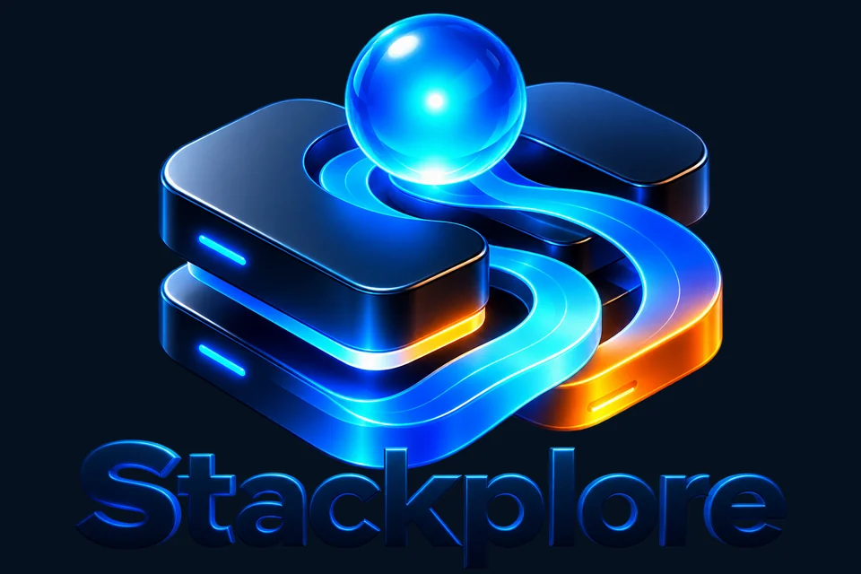
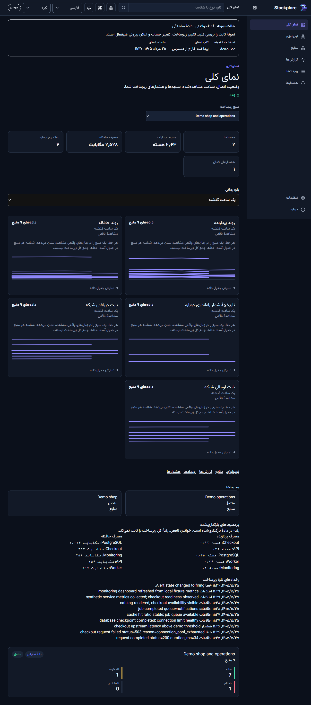
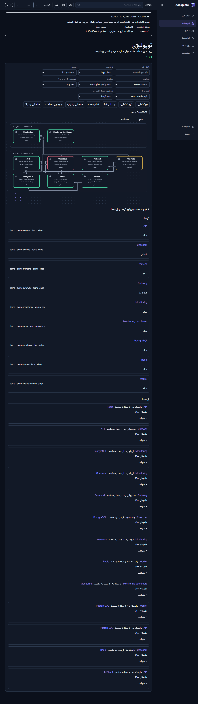
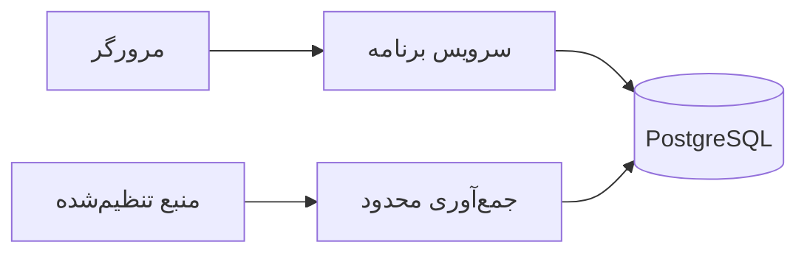

# معرفی Stackplore

Stackplore فضای خودمیزبان برای دیدن و بررسی زیرساخت است. تیم می‌تواند
منابع، سلامت، ارتباط‌ها، سنجه‌ها، رویدادها، گزارش‌ها و هشدارها را در یک
رابط فارسی و انگلیسی ببیند و از نمای کلی به منبع موردنظر برسد.

## وضعیت محصول

| بخش | وضع |
| --- | --- |
| نسخهٔ پایدار | `1.0.3`، با طرح پایگاه دادهٔ ۱۷ و [رسید انتشار](evidence/1.0.3/published-release.json) |
| پیش‌نمایش نسخهٔ ۲ | `2.0.0-alpha.6.3`، با طرح ۱۹ و [رسید منبع، گیت تگ، انتشار و محدودیت‌ها](evidence/2.0.0-alpha.6.3/README.md) |
| نسخهٔ ۲ پایدار | در دست ساخت؛ گام ۶ و گام‌های بعد هنوز پذیرفته نشده‌اند. [دفتر پیشرفت](v2/implementation.md) |

عکس‌های رابط در این سند از اجرای نمایشی نسخهٔ **۱٫۰٫۳** هستند. آن‌ها نمونهٔ
رابط‌اند و ظاهر نسخهٔ تازه یا نصب واقعی شما را ثابت نمی‌کنند. داده‌های عکس‌ها
ساختگی‌اند. نشان بالای سند، نشان فعلی پروژه است.

## چه کسی و برای چه کاری؟

مدیر زیرساخت می‌تواند منبع‌ها را راه‌اندازی و تنظیم کند و دسترسی و هشدارها
را بررسی کند. مشاهده‌گر می‌تواند در محدودهٔ مجاز وضعیت و جزئیات را ببیند.
حالت نمایشی برای آشنایی با جریان کار از دادهٔ ساختگی استفاده می‌کند.
نقش‌ها در سطح نصب تعریف می‌شوند؛ انتخاب منبع یا محیط به‌تنهایی مرز مستقل
دسترسی میان تیم‌ها نمی‌سازد.

## نمای کلی

نمای کلی وضعیت اتصال، محیط‌ها، سلامت، سنجه‌ها، هشدارها و رویدادهای اخیر را
کنار هم می‌گذارد. بازه و منبع انتخاب‌شده به خواندن داده جهت می‌دهند. وضعیت
ناقص، کهنه، ناموجود یا بدون مجوز باید همان‌طور نشان داده شود؛ نبود داده
به معنی سلامت نیست.

## نقشهٔ ارتباط‌ها

توپولوژی منابع و ارتباط‌های مشاهده‌شده را نشان می‌دهد. کاربر می‌تواند با
فیلترها و فهرست جایگزین، رابطه‌ها را بررسی کند. یال‌ها فقط آنچه را منبع
گزارش کرده نشان می‌دهند؛ کامل بودن یک نقشه به پوشش و مجوز منبع وابسته است.

## بخش‌های اصلی

| بخش | کاربرد |
| --- | --- |
| منابع | جست‌وجو، فیلتر، صفحه‌بندی و دیدن جزئیات منبع |
| سلامت و سنجه‌ها | بررسی وضعیت و داده‌های موجود در محدودهٔ منبع |
| گزارش‌ها و رویدادها | دیدن اطلاعات مجاز برای بررسی یک وضعیت |
| هشدارها | بررسی وضعیت، قاعده و تاریخچهٔ هشدارهای ثبت‌شده |
| تنظیمات | مدیریت نصب، حساب‌ها و منبع‌ها بر پایهٔ نقش |
| ناوبری سریع | رفتن به بخش‌های مجاز با دکمهٔ سربرگ یا `Ctrl+K` / `Command+K` |

راهنمای جزئی‌تر در [بررسی مشاهده‌ها](exploration.fa.md)،
[مشاهده‌ها و تنظیم منبع](observations.fa.md) و [دمو](demo.fa.md) است.

## Smart Assistant و Smart Analysis

در نسخهٔ آزمایشی `alpha.6.1`، گفت‌وگوی یک منبع و بررسی محدود با درخواست
کاربر و پروفایل محلیِ تنظیم‌شده توسط اپراتور در دسترس است. این قابلیت
پیش‌فرض خاموش است. پاسخ می‌تواند به شاهد مجاز ارجاع بدهد و پوشش یا کمبود
داده را نشان دهد. خواندن گزارش‌ها رضایت جداگانهٔ محلی می‌خواهد. جزئیات و
محدودیت‌ها در [راهنمای بررسی](v2/investigation.md) آمده است.

پیش‌نمایش `alpha.6.2` اتصال مجاز تاریخچه به گزارش رخداد و شاهد را دارد؛
این پذیرش، کیفیت همهٔ پاسخ‌ها یا نصب واقعی شما را ثابت نمی‌کند. نتیجهٔ
آزمایش یک نسخه به معنی تأیید نسخهٔ دیگر نیست.

تاریخچهٔ هشدار و نمونه‌های بار کاری با خواندن مجاز به گزارش و شاهد وصل می‌شود.
پیش‌نمایش `alpha.6.3` صفحهٔ جدا برای
تاریخچهٔ حساب دارد: ده ردیف، فیلتر وضعیت و صفحه‌بندی؛ فقط فرادادهٔ همان مالک
در هفت روز گذشته. این صفحه پرسش، پاسخ یا گزارش منقضی‌شده را بازسازی نمی‌کند.
تأیید اسناد مرجع، جست‌وجوی آن‌ها، ارزیابی انسانی و پایلوت هنوز گام‌های بازند.
[وضع دقیق و مرز پذیرش](v2/runbooks.md).

## منبع‌ها و معماری

منبع نمایشی، Docker و Kubernetes از مسیرهای نوع‌دار جدا استفاده می‌کنند.
دسترسی واقعی به تنظیمات، مجوز و پوشش هر محیط بستگی دارد. راهنمای
[Docker](docker-provider.fa.md) و [Kubernetes](kubernetes-provider.fa.md)
محدوده و پیش‌نیازها را توضیح می‌دهد.

برنامه دادهٔ عادی‌شده را با هویت منبع و وضعیت پوشش نگه می‌دارد. PostgreSQL
پایگاه دادهٔ پشتیبانی‌شده است. رابط وب با React و سرویس با Go ساخته شده‌اند؛
قرارداد HTTP در [OpenAPI](../contracts/openapi.yaml) ثبت شده است.

## امنیت و نگهداری

مشاهده به‌طور پیش‌فرض فقط‌خواندنی است. عملیات زیرساختی مجاز، مسیر جدا با
نقش مدیر، مجوز صریح، پیش‌نمایش و تأیید دارد؛ هر منبع از همهٔ عملیات پشتیبانی
نمی‌کند. دسترسی به حساب با نشست محافظت‌شده و کنترل‌های سمت سرور سنجیده
می‌شود. رازهای ارائه‌دهنده نباید در پاسخ یا گزارش عمومی ظاهر شوند.

برای نصب، ارتقا و بازیابی از راهنمای همان نسخه استفاده کنید. پیش از ارتقا
پشتیبان را طبق [راهنمای ارتقا و بازگشت](operations/upgrade-rollback.fa.md)
بگیرید و بازیابی را بیازمایید. [راهنمای استقرار](operations/deployment.md)
مسیر Compose و شرایط آن را شرح می‌دهد. نصب مشتری، مجوز منبع، رسید اعلان و
ظرفیت عملیاتی نیاز به بررسی جدا دارند.

## شروع بررسی

1. برای شناخت رابط، [راهنمای دمو](demo.fa.md) را بخوانید.
2. برای اتصال منبع واقعی، راهنمای همان منبع و [تنظیم منبع](observations.fa.md) را بخوانید.
3. برای نصب یا ارتقا، از [راهنمای استقرار](operations/deployment.md) و
   [بازیابی](operations/upgrade-rollback.fa.md) نسخهٔ انتخاب‌شده پیروی کنید.
4. برای وضع کار نسخهٔ ۲، [دفتر پیشرفت](v2/implementation.md) و
   [نقشهٔ راه](roadmap-v2.fa.md) را ببینید.
