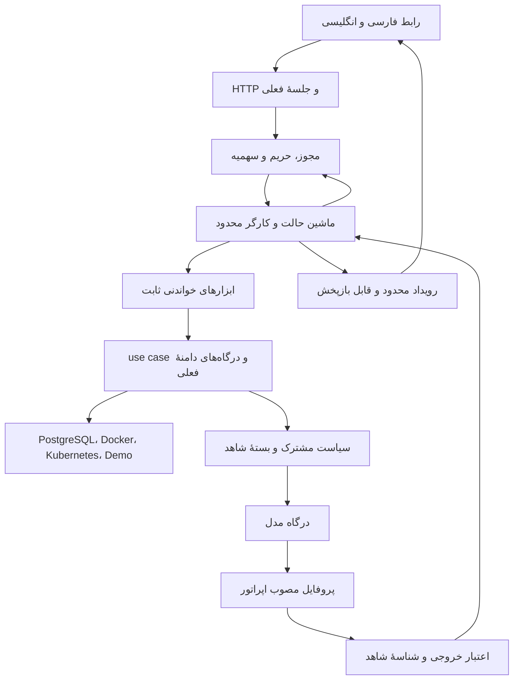

# نقشهٔ نسخهٔ ۲ Stackplore

[English](roadmap-v2.md). تاریخ: **۲۰۲۶-۱۰-۱۹**. وضعیت: **اجرا مجاز؛ طراحی گام صفر در ADRهای ۰۰۱۴ تا ۰۰۱۶ پذیرفته؛ قابلیت اجرا هنوز تحویل نشده**. [رسید فعال](v2/implementation.md) مرجع وضع واقعی گام‌ها باشد.
پایهٔ منتشرشده **۱٫۰٫۳**، تگ `v1.0.3`، منبع `656581cf05d4774358d5644a6e1af3c69a210f81` و schema **۱۷** است.
[رسید نسخهٔ ۱](evidence/1.0.3/published-release.json) فقط همان نسخه را ثابت کند. کامیت داک `c018cf0` منبع باینری انتشار نیست.
محدوده و رسید تاریخی نسخهٔ ۱ حفظ شود. طراحی تازه در بخش ۱۵ [SPEC](../SPEC.md) و [تصمیم‌های پذیرفته](adr/README.md) افزوده شد؛ قرارداد قابلیت فقط همراه پیاده‌سازی تغییر کند.
تصمیم‌های گام صفر پذیرفته؛ کاربر، اجرای گام‌ها و کامیت/پوش را مجاز کرده. طرح به تنهایی مدرک پایان یا مجوز دور زدن گیت نیست.

## Smart Assistant

### هدف و مرز

- کاربر از وضع زیرساخت بپرسد؛ یار، دادهٔ مجاز بخواند، شاهد نشان دهد، فرضیه بسازد، کمبود داده را بگوید.
- شروع فقط با خواست کاربر. گفت‌وگو، شرح هشدار و بررسی چندگامی خواندنی در محدودهٔ ۲٫۰.
- قابلیت پیش‌فرض خاموش. نسخهٔ ۱ بدون اتصال مدل، کامل کار کند. حالت Demo، ساختگی و روشن برچسب بخورد. مهمان عمومی، تماس پولی یا بیرونی نداشته باشد.
- اجرای خودکار، ترمینال، shell، exec، SQL خام، proxy آزاد، خواندن مقدار Secret، نصب و deploy دلخواه بیرون طرح.
- مدل یا چارچوب خاص اکنون انتخاب نشود. گام صفر: کیفیت فارسی/انگلیسی، قابلیت خروجی نوع‌دار، لغو، حریم، مجوز بهره‌برداری، سخت‌افزار و هزینهٔ واقعی سنجیده شود.
- SSO، چندمستاجری، مجوز ریزِ منبع، مقیاس افقی، فراهم‌کنندهٔ تازه و انبار بردار شرط پایان ۲٫۰ نشوند.

### معماری پیشنهادی

همان یک خدمت Go، همان React/TypeScript، همان PostgreSQL. صف کار و سهمیه در PostgreSQL؛ خدمت صف تازه لازم نیست.
سرور مدل، وابستگی اختیاریِ جدا و تحت مدیریت اپراتور؛ داخل باینری Stackplore جاسازی نشود.
بخش تازه بسته‌های کوچک داشته باشد؛ فایل بزرگِ همه‌کاره ساخته نشود.

نمودار، جریان کار است. جهت وابستگی کد همان `transport/jobs → use cases → domain ports ← adapters` بماند.
SDK زیرساخت و جزئیات پردازنده از آداپتور بیرون نروند. خروجی مدل، فقط پیشنهاد نوع‌دار؛ مجوز ابزار در کد قطعی.

| بخش پیشنهادی                                    | کار و مرز                                                               |
| ----------------------------------------------- | ----------------------------------------------------------------------- |
| `internal/assistant`                            | گفتگو، نوبت، اجرا، لغو، ماشین حالت و هماهنگ‌سازی؛ نه کلاینت خام زیرساخت |
| `internal/assistantpolicy`                      | حق کاربر، دامنهٔ اجرا، خروج داده، سقف و کلید توقف                       |
| `internal/contextbuilder`                       | شاهد مجاز، کمینه، زمان‌دار و محدود؛ فقط پس از سیاست مشترک               |
| `internal/inference` و آداپتور آن               | درگاه خنثی، قابلیت پروفایل، ورودی/خروجی بسته، مهلت و لغو                |
| مخزن‌های use-case-shaped در `internal/postgres` | پذیرش اتمی کار، رزرو سهمیه، lease/fencing، نتیجه و رویداد امن           |
| `features/assistant` و `features/analysis`      | سفر کاربر، استناد، وضعیت، دسترس‌پذیری و رشته‌های دو زبان                |

نام‌ها پیشنهادی. [درگاه مشاهدهٔ موجود](../apps/api/internal/domain/observation_ports.go)،
[سیاست لاگِ مسیر HTTP](../apps/api/internal/httpapi/configured_logs.go)،
[صف زنده](../apps/api/internal/realtime/hub.go) و [عملیات فعلی](../apps/api/internal/operation/service.go) پایهٔ بازاستفاده‌اند.
سیاست لاگِ HTTP به تنهایی مرز مشترک نیست؛ ابزار تازه نباید با دور زدن آن، فیلد حساس بگیرد.

### قرارداد و ذخیره

- نسخهٔ محصول ۲ به معنی تغییر خودکار `/api/v1` نیست. مسیرهای سازگارِ پیشنهادی زیر `/api/v1/assistant` و `/api/v1/analysis`؛ قرارداد قطعی در گام صفر/مرحلهٔ مالک، سپس تولید نوع‌های مرورگر.
- ساخت اجرا، وضعیت/نتیجه، لغو، فهرست metadata و جریان رویداد لازم. schema بسته؛ فیلد ناشناخته، عدد نامعتبر، شناسهٔ بیرون دامنه و اندازهٔ زیاد رد شود.
- جدول‌های پیشنهادی: گفتگو/نوبتِ بدون متن، اجرا، گام، مرجع شاهد، رزرو مصرف، رویداد وضعیت و سند راهنمای مصوب. نام و migration واقعی هنگام کد؛ شمارهٔ بعد از ۱۷ اکنون رزرو نشود.
- هر اجرا به actor، جلسهٔ معتبر با مرجع امن، منبع و نسخه، هدف/بازه، نسل restore، نسخهٔ سیاست/ابزار/پردازنده/قالب پرسش و بستهٔ شاهد بسته شود.
- وضعیت‌ها: `queued`, `running`, `completed`, `failed`, `cancelled`, `expired`, `interrupted`, `uncertain`. گذار با CAS/version و lease دارای fencing؛ تماس شبکه بیرون تراکنش.
- کلید idempotency به actor، نوبت و fingerprint امنِ درخواست بسته شود. شمارش هزینه و رخداد نتیجه دوباره ثبت نشوند. تماس بیرونی «دقیقاً یک بار» وعده داده نشود.
- صفِ هدف نوع‌دار پس از restart فقط با مجوز و سهمیهٔ معتبر قابل claim دوباره است. متن آزادِ از دست‌رفته `interrupted`؛ کاربر دوباره وارد کند. درخواست مدل با نتیجه/هزینهٔ نامعلوم خودکار تکرار نشود.
- قطع مرورگر فقط اتصال رویداد را ببندد. دکمهٔ لغو، توقف پایدار ثبت کند. خروج حساب، تعلیق، تغییر مجوز، قطع منبع و تغییر سیاست، کار خواندنی را باطل کنند.
- پیش از لغو producer، صف و بازپخش بسته/پاک شود؛ نتیجهٔ دیررس با fencing رد شود. بایت قبلاً فرستاده‌شده قابل پس‌گرفتن نیست.

### امنیت و حریمِ پایه

نقش‌های فعلی نصب‌سراسری‌اند؛ viewer همهٔ منابع مجاز نصب را می‌بیند. انتخاب منبع/محیط فقط دامنهٔ پرسش است، مجوز ریز نیست.
گفتگو و اجرای شخصی owner-only؛ مدیر حقِ خودکار برای خواندن متن شخصی نگیرد. audit امن، metadata لازم را داشته باشد.
مجوز زیرساخت و مالکیت گفتگو جدا؛ هر خواندن، هر صفحه، دریافت نتیجه و بازپخش دوباره بررسی شوند.

| مرز               | قاعدهٔ پیشنهادی                                                                                                                       |
| ----------------- | ------------------------------------------------------------------------------------------------------------------------------------- |
| پردازندهٔ محلی    | origin/پورت/CA و شبکه فقط اپراتور؛ TLS بیرون loopback؛ IP خصوصی فقط در پروفایل مصوب؛ metadata/link-local/multicast رد                 |
| پردازندهٔ بیرونی  | HTTPS، DNS/IP و pin در هر تلاش، بدون redirect یا proxy محیط؛ مقصد/کلید در مرورگر یا متن پرسش پذیرفته نشود                             |
| خروج داده         | پیش‌فرض صفر؛ فعال‌سازی اپراتور و نمایش مقصد، نوع داده، بازه و سقف پیش از اجرای مجاز؛ بدون fallback پنهان به پردازندهٔ دیگر            |
| حالت بیرونیِ پایه | فقط هدف‌ها و پرسش‌های ساختاریِ مصوب و دادهٔ allowlist؛ متن آزاد و بدنهٔ لاگ بیرون فرستاده نشوند. گسترش، ADR حریم و مدرک جدا لازم دارد |
| ورودی محلی        | متن آزاد محدود و موقت؛ ورود راز منع و الگوهای شناخته‌شده رد/پوشانده شوند. تشخیص الگویی تضمین نبود راز در هر متن نیست                  |
| ابزار             | فهرست ثابت خواندن inventory/health/metrics/events/topology و لاگ انتخابی محلی؛ نه fetch URL، نه SQL، نه کد یا افزونهٔ اجرایی دلخواه   |
| متن نامطمئن       | نام، label، لاگ، سند، پاسخ ابزار و خروجی مدل داده‌اند؛ نتوانند سیاست یا حق ابزار را عوض کنند                                          |
| زمینه             | allowlist ساختاری پیش از پوشاندن متن؛ credential، header، session، proof تأیید و کلید نویسنده هرگز وارد زمینه نشوند                   |
| خروجی             | schema و استناد سمت سرور اعتبار بگیرد؛ HTML، تصویر بیرونی، لینک و fetch دلخواه مدل ممنوع؛ فقط بخش معتبر منتشر شود، نه توکن خام        |
| تاریخچه           | raw prompt، پاسخ مدل، بدنهٔ ابزار/لاگ و فکر درونی در DB، audit، trace و خطا ثبت نشوند؛ فقط metadata، هدف نوع‌دار و مرجع امن           |

سیاست public-IP اعلان‌ها شل نشود؛ شبکهٔ مدل، پروفایل جدا لازم دارد.
شرایط نگهداری/استفاده از داده در هر پردازنده در گام صفر بررسی شود؛ قرارداد Stackplore، حذف یا عدم آموزش در خدمت بیرونی را خودکار تضمین نکند.
نمایش وضعیت و خلاصهٔ کار کافی است؛ فکر درونی نمایش/ذخیره نشود.

### سقف‌های آغازین؛ پیشنهاد، نه اندازه‌گیری

گام صفر این عددها را با پروفایل واقعی ببندد. هر حد، با حد سخت‌ترِ نسخهٔ ۱ و تنظیم مؤثر clamp شود.

| مورد                    | سقف پیشنهادی                                                                               |
| ----------------------- | ------------------------------------------------------------------------------------------ |
| کار هم‌زمان             | هر کاربر ۱؛ کل نصب ۲؛ خواندن موازی در هر اجرا ۲                                            |
| صف                      | کل نصب ۱۶؛ هر کاربر ۲؛ بیش از آن رد روشن با امکان تلاش بعد                                 |
| طول اجرا                | ۱۲۰ ثانیه؛ حداکثر ۱۲ فراخوان ابزار و ۳ فراخوان مدل؛ هر فراخوان مدل ۲۵ ثانیه                |
| زمینهٔ مدل              | حداکثر ۶۴ KiB و ۱۶٬۰۰۰ توکن ورودی؛ هر دو لازم. شمارندهٔ معتبر نیست، پروفایل آماده نشود     |
| خروجی                   | ۴٬۰۹۶ توکن و ۶۴ KiB خروجی decodeشده؛ حد پس از بازکردن فشرده‌سازی هم اعمال شود              |
| رویداد مرورگر           | هر frame حداکثر ۱۶ KiB؛ هرگز بیشتر از cap نسخهٔ ۱؛ overflow به refetch محدود/بستن امن برسد |
| لاگ انتخابی محلی        | حداکثر ۲۰۰ خط، ۳۲ KiB، بازهٔ ۱۵ دقیقه و حق مؤثر فعلی؛ خاموش پیش‌فرض، رضایت روشن در هر اجرا |
| حافظهٔ موقت گفتگو       | حداکثر ۳۰ دقیقه یا ۸ نوبت، هر کدام زودتر؛ سقف بایت/تعداد گفتگو هم در گام صفر بسته شود      |
| metadata و بازپخش وضعیت | metadata هفت روز؛ رویداد وضعیت ۲۴ ساعت؛ پاک‌سازی دسته‌ای محدود                             |

هزینه/مصرف پیش از dispatch اتمی رزرو شود. مصرف واقعی یا `unknown` تسویه شود؛ هزینهٔ نامعلوم صفر یا خودکار refund نشود.
حد پولی فقط با واحد، نرخِ معتبرِ نسخه‌دار و منبع معلوم؛ بدون آن سقف واحد مصرف نشان داده شود، نه قیمت ساختگی.
retry نامطمئن یا پاسخ نیمه‌دریافت‌شده خودکار نباشد. تلاش تازهٔ کاربر، اجرای تازه و رزرو روشن داشته باشد؛ ارسال تکراری همان درخواست با همان idempotency، فقط همان اجرای قبلی را برگرداند.
metadata پاک شود، audit محافظت‌شده حذف نشود. حذف از DB به معنی پاکی WAL/backup نیست.
رزرو هزینهٔ `unknown` از انقضای هفت‌روزهٔ metadata جدا بماند. پاک‌سازی، شروع دورهٔ سهمیه یا restore آن را آزاد/صفر نکند.
دفتر مصرفِ کمینه و امن تا تطبیق با رسید مصرف یا تسویهٔ محافظه‌کارانهٔ اپراتور بماند؛ تسویه، دلیل و audit لازم دارد. تاریخچهٔ متن با این بهانه ذخیره نشود.
backup قدیمی شاید تماس پولیِ پس از خود را نداشته باشد. پس از restore، کار پولی بسته بماند تا اپراتور بازهٔ گمشده را تطبیق دهد یا بیشینهٔ تعهد آن را در نسل تازه رزرو کند. ماندهٔ قدیمی، مدرک سهمیهٔ آزاد نیست.

### ترتیب، نسخه و برآورد

همهٔ گام‌های ۰ تا ۱۰ برای محدودهٔ ۲٫۰ لازم. ترتیب اصلی خطی؛ پس از گام ۳، کار رابط و fixtureها موازی شود، ولی گیت خروج جلو نیفتد.
شماره‌ها هدف آینده‌اند، نه تگ موجود. پشتیبانی و وصلهٔ نسخهٔ ۱ جدا ادامه یابد.

| گام | خروجی                            | نسخهٔ هدف                | نفرروز تقریبی |
| --- | -------------------------------- | ------------------------ | ------------- |
| ۰   | دامنه، ADR، تهدید و معیار مرجع   | `2.0.0-alpha.0`          | ۳–۵           |
| ۱   | درگاه مدل و سیاست خروج           | `2.0.0-alpha.1`          | ۴–۷           |
| ۲   | اجرای پایدار، سهمیه و لغو        | `2.0.0-alpha.2`          | ۶–۱۰          |
| ۳   | سیاست مشترک، شاهد و ابزار خواندن | `2.0.0-alpha.3`          | ۵–۸           |
| ۴   | گفت‌وگوی مستند دو زبان           | `2.0.0-alpha.4`          | ۵–۸           |
| ۵   | بررسی چندگامی محدود              | `2.0.0-alpha.5`          | ۶–۱۰          |
| ۶   | تحلیل رخداد و فرضیه              | `2.0.0-alpha.6`          | ۶–۱۰          |
| ۷   | راهنمای مصوب و حافظهٔ کمینه      | `2.0.0-alpha.7`          | ۴–۷           |
| ۸   | ارزیابی، حمله و سخت‌سازی         | `2.0.0-alpha.8`          | ۶–۱۰          |
| ۹   | بتا، نصب و بهره‌برداری واقعی     | `2.0.0-beta.1`           | ۵–۸           |
| ۱۰  | نامزد و انتشار پایدار            | `2.0.0-rc.1` سپس `2.0.0` | ۳–۵           |

جمع **۵۳–۸۸ نفرروز مهندسی**؛ با حاشیهٔ ۲۵٪، حدود **۱۴–۲۲ هفته** برای یک توسعه‌دهنده، با بازبینی جدا.
برآورد است، تعهد نیست؛ سخت‌افزار، پردازنده، fixtureها و نیاز حقوقی داده هنوز بسته نیست. گام صفر برآورد را نو کند.
اجرای پیشنهادی ۲٫۱ در این جمع نیست. الگوی prerelease در دو بررسی نسخه/انتشار فعلی پذیرفته می‌شود؛ مسیر کامل Helm/OCI/آرشیو/مصرف‌کننده هنوز در گام صفر آزموده شود.

### گام ۰ — بستن دامنه

- **کار/معماری:** نیاز→مسیر→قرارداد→تست؛ ADRهای دامنه، درگاه، حریم لاگ، ذخیره، صف/لغو، خروج شبکه و سهمیه. پروفایل محلی و بیرونی با معیار روشن مقایسه شوند؛ نام/نسخهٔ برنده پس از سنجش.
- **امنیت:** جریان داده و دارایی حساس؛ RBAC فعلی در برابر owner گفتگو؛ سیاست بیرونیِ ساختاری؛ raw متنِ موقت؛ رضایت، key reference، retention و کلید توقف نوشته شوند.
- **تست:** corpus نسخه‌دار و holdout مستقل، موارد محروم/ناقص و حمله؛ مرور مستقل همهٔ مرزها؛ برنامهٔ migration از ۱۷ و restore؛ نمونهٔ prerelease همهٔ مسیرهای نسخه را طی کند.
- **خروج:** تصمیم‌های لازم پذیرفته؛ ماتریس اختیار، سقف‌ها، معیار کیفیت، طرح قرارداد و manifest ارزیابی موجود. هیچ رفتار تازه shipped خوانده نشود.

### گام ۱ — درگاه و شبکه

- **کار/معماری؛ نیاز ۰:** port خنثی و یک آداپتور منتخب؛ قابلیت خروجی بسته/شمارش/لغو، پروفایل اپراتور، مرجع کلید و تست اتصالِ مصنوعی کم‌هزینه.
- **امنیت:** خاموش یعنی صفر تماس؛ TLS/DNS/IP/redirect/proxy و اندازه/مهلت روی هر تلاش؛ خروج دادهٔ واقعی در تست اتصال ممنوع؛ خطای امن و بدون raw body.
- **تست:** سرور TLS آزمایشی واقعی، CA/نام غلط، DNS مخلوط و rebind، مقصد metadata، redirect، پاسخ خراب/بزرگ/فشرده/کند، لغو و قطعی؛ capture گیرنده برای صفر تماس در حالت خاموش.
- **خروج:** اتصال واقعی منتخب با دادهٔ ساختگی ثابت شود؛ قطع آن readiness بخش مشاهده را بی‌دلیل خراب نکند. راهنمای پروفایل، حریم و دامنهٔ پشتیبانی دو زبان آماده.

### گام ۲ — موتور اجرای پایدار

- **کار/معماری؛ نیاز ۱:** مخزن‌های تراکنشی، صف محدود، worker، lease/CAS/fencing، idempotency، رزرو سهمیه، SSE وضعیت و لغو پایدار.
- **امنیت:** owner و جلسه پیش از هر claim/گام/پخش؛ actor یا نسل نامعتبر رد؛ audit امن مستقل؛ تماس شبکه بیرون تراکنش و خطای دیررس بی‌اثر.
- **تست:** PostgreSQL واقعی؛ migration، دو claimant، انقضای lease، crash در مرزها، تکرار/تعارض idempotency، رزرو هم‌زمان، لغو/لغو تکراری، restore، replay کاربر دیگر؛ انقضای metadata و reset سهمیه، رزرو نامعلوم را آزاد نکنند؛ دو تسویهٔ هم‌زمان یک اثر داشته باشند. race و قطع اتصال HTTP واقعی.
- **خروج:** نتیجه و مصرف دوباره ثبت نشوند؛ کار نامعلوم دوباره dispatch نشود؛ جدول‌ها/indexها و `EXPLAIN (ANALYZE, BUFFERS)` مسیرهای داغ ثبت شوند. داک حالت‌ها و failure recovery حاضر.

### گام ۳ — شاهد و ابزار محدود

- **کار/معماری؛ نیاز ۲:** سیاست مؤثر لاگ/رویداد از مسیر وب به use case مشترک برسد؛ ابزار ثابت موجودی، سلامت، متریک، رویداد، توپولوژی و لاگِ محلیِ انتخابی؛ صفحه و زمان محدود.
- **امنیت:** مجوز قبل از pagination و هر ادامه؛ شاهد شامل زمان/بازه/منبع/نسخه/کیفیت/synthetic؛ allowlist و سپس redaction، نه payload خام. خاموشی/محرومیت منبع، زمینه و replay را باطل کند.
- **تست:** PostgreSQL و Docker/Kubernetes واقعیِ disposable؛ محرومیت صفحهٔ بعد، منبع دیگر، دادهٔ stale/partial/unsupported، متریک غایب، ساعت Demo، متن مخرب و پوشاندن فیلد افزوده. گیرنده، DB و log بررسی شوند تا دادهٔ منع‌شده نرفته باشد.
- **خروج:** بستهٔ شاهد فقط مجاز و زیر سقف؛ API مشاهدهٔ فعلی پس‌رفت نکند. قرارداد ابزار/شاهد و جدول طبقه‌بندی داده ثبت شود.

### گام ۴ — گفت‌وگوی مستند

- **کار/معماری؛ نیاز ۳:** صفحهٔ تازه و ورودی از منبع/هشدار با scope همان صفحه؛ پرسش، استناد سروری، پاسخ نوع‌دار، وضعیت، لغو و خطای قابل بازیابی؛ فارسی و انگلیسی از همین گام.
- **امنیت:** واقعیت/فرضیه/نامعلوم جدا؛ شاهد ساختگی رد؛ لینک فقط سرور بسازد؛ خروجی نامعتبر نهایی نشود. هیچ private API/SSE/گفتگو در PWA cache نرود. متن خام مدل stream نشود.
- **تست:** مرورگر واقعی؛ RTL/LTR، موبایل، keyboard/focus، live status، reduced motion، HTML/Markdown مخرب، تصویر بیرونی، logout، تغییر منبع، expiry، overflow/reconnect و نبود داده.
- **خروج:** کاربر پاسخ را به شاهد و بازهٔ دقیق برساند؛ وضعیت loading/empty/stale/unavailable/unsupported/denied/budget/cancel/error روشن. نوع‌ها، رشته‌ها و راهنمای کاربر دو زبان آماده.

### گام ۵ — بررسی چندگامی

- **کار/معماری؛ نیاز ۴:** هدف نوع‌دار → پیشنهاد گام → schema/policy → ابزار خواندن → شاهد تازه → جواب یا توقف. تشخیص حلقه، بودجهٔ کامل، پیشرفت قابل دیدن؛ فکر درونی نمایش نگیرد.
- **امنیت:** مدل مالک مجوز نیست؛ ابزار ناشناخته و گام بیرون scope رد؛ هر دور حق/تازگی دوباره سنجیده شود؛ متن نامطمئن نتواند سقف یا مقصد را عوض کند.
- **تست:** ابزارِ کند/گیرکرده، زنجیرهٔ بی‌پایان، نتیجهٔ تکراری/دیررس، بودجهٔ تمام، قطع/restore، لغو هنگام چند خواندن و فشار صف؛ مدل واقعی با fixture مصنوعی، نه فقط mock.
- **خروج:** کار در سقف تمام یا با علت روشن متوقف شود؛ اجرای لغوشده زنده نشود؛ هزینهٔ unknown روشن؛ راهنمای الگوریتم و قطع/بازیابی کامل.

## Smart Analysis

### گام ۶ — تحلیل رخداد

- **کار/معماری؛ نیاز ۵:** خط زمانی، تغییرات اطراف رخداد، فرضیهٔ رتبه‌دار، شاهد موافق/خلاف، کمبود داده و گام بعدِ خواندنی. هم‌بستگی، علت قطعی نام نگیرد.
- **امنیت:** گزارش به scope/نسخه/زمان بسته؛ اجرای دوباره گزارش تازه بسازد. درصد اطمینان خودساخته نباشد؛ درجهٔ پوشش و تازگی شاهد نمایش یابد.
- **تست:** سناریوی سالم، OOM، CrashLoop، rollout، فشار ظرفیت، قطعی DNS، متریک غایب، چند علت، ساعت ناهماهنگ، خطای ناشناخته و شواهد متناقض؛ هر دو زبان و هر سه provider.
- **خروج:** fixtureهای مرجع جوابِ مستند یا abstention درست بگیرند؛ علت قطعیِ بی‌شاهد و پیشنهاد ناامن رد. قالب گزارش و مرز بازتولید ثبت شود.

### گام ۷ — دانش مصوب و حافظهٔ کمینه

- **کار/معماری؛ نیاز ۶:** runbookهای دارای منشأ/نسخه/مجوز و مجوز استفاده؛ retrieval پارامتری و محدود در PostgreSQL؛ metadata گفتگو/گزارش و export انتخابی. انبار بردار یا embedding لازم نیست.
- **امنیت:** corpus فقط بستهٔ همراه یا ورودی مصوب اپراتور؛ مرورگر path/URL آزاد ندهد. سند هم دادهٔ نامطمئن است، کد/فرمانش اجرا نشود. raw لاگ/متن گفتگو به نام memory ذخیره نشود.
- **تست:** سند آلوده، نسخهٔ منقضی، درخواست بیرون دامنه، حذف/ابطال/retention، backup/restore واقعی و پایان اعتبار شاهد؛ حذف metadata نباید audit را cascade کند.
- **خروج:** پاسخ قابل ردیابی به نسخهٔ سند؛ مرجع منقضی «ناموجود» شود، با دادهٔ تازه بی‌صدا جایگزین نشود. سیاست حذف، backup، export و مجوز corpus نوشته شود. حافظهٔ متنِ ماندگار، ADR و دامنهٔ جدا بخواهد.

### گام ۸ — ارزیابی و سخت‌سازی

- **کار/معماری؛ نیاز ۷:** runner ارزیابی، corpus بسته، نسخهٔ قالب/ابزار/پردازنده و گزارش مقایسه؛ سنجهٔ کیفیت/تاخیر/مصرف/حافظه؛ کلید توقف و محدودیت overload.
- **امنیت:** تزریق دستور از پرسش/نام/لاگ/رویداد/سند، جعل شاهد، خروج داده، Unicode/encoding، دور زدن quota و owner، نتیجهٔ دیررس و لینک بیرونی آزموده شوند.
- **تست:** معیارهای عددی بخش بعد، race/fuzz، HTTP واقعی، منابع واقعی disposable، ۶۰ دقیقه soak و ۱۰۰ چرخهٔ create/cancel/reconnect؛ قطع مدل/DB/provider و ownership loss.
- **خروج:** همهٔ گیت‌ها برای هر پروفایل پشتیبانی‌شده بگذرند؛ خطای شدید باز صفر در مجموعهٔ سنجش؛ رگرسیون نسخهٔ ۱ در سقف. گزارش failureها هم بماند؛ مدلِ ارزیاب تنها داور نباشد.

### گام ۹ — بتا و عملیات

- **کار/معماری؛ نیاز ۸:** cohort محدود با فعال‌سازی اپراتور؛ نصب تازه و ارتقا از ۱٫۰٫۳، داشبورد مصرف امن، status مؤلفه و runbook قطع پردازنده. بازخورد حساس ذخیره نشود.
- **امنیت:** rollout انتخابی؛ feature-off، allowlist خروج، کلید توقف و مرجع کلید؛ ظرفیت هر سخت‌افزار/پروفایل جدا. کمبود مدل به مسیرهای عادی نسخهٔ ۱ ضربه نزند.
- **تست:** PostgreSQL واقعی از schema ۱۷، migration lock/checksum، restore و ابطال جلسه/اجرای قدیمی؛ native، Compose restart، Helm با DB بیرونی TLS و RBAC محدود؛ اتصال واقعی محلی/بیرونیِ انتخاب‌شده با دادهٔ غیرحساس.
- **خروج:** گزارش بتا و محدودهٔ پروفایل‌های واقعاً آزموده روشن؛ راهنمای نصب، ارتقا، مصرف، privacy، رخداد و troubleshooting دو زبان آماده. rollback با DB قدیمیِ خالی و backup پیش از migration؛ باینری نسخهٔ ۱ روی schema تازه اجرا نشود.

### گام ۱۰ — نامزد و انتشار

- **کار/معماری؛ نیاز ۹:** freeze، رفع باگ مانده، `rc.N` تازه برای هر اصلاح؛ سپس منبعِ مستقلِ نسخهٔ پایدار `2.0.0` و داک منطبق.
- **امنیت:** اسکن کد/وابستگی/باینری/تصویر برنامه و DB، Secret scan، SBOM، منشأ امضاشده و بررسی مستقل؛ قالب یا پردازندهٔ عوض‌شده دوباره ارزیابی شود.
- **تست:** full gate، هر شش CI روی منبع دقیق، مرورگر و provider واقعی، نصب/ارتقا/restore، trial امضاشده و دریافت/اجرای آرشیو عمومی؛ پلتفرم cross-built با runtime-tested قاطی نشود.
- **خروج:** ۲٫۰ فقط با رسید همان source/tag/processor profile پذیرفته شود؛ مدرک RC جای stable ننشیند. تگ قبلی عوض نشود؛ final docs commit هم CI خودش را داشته باشد. محدودیت مشتری و بازگشتِ همراهِ از دست‌رفتن نوشته‌های پس از backup روشن بماند.

### معیار کیفیت و تست

همهٔ عددهای زیر **هدف پیشنهادی** هستند؛ هنوز نتیجهٔ آزمایش نیستند. در گام صفر ثبت و نسخه‌دار شوند.

| گیت            | حد پیشنهادی و مدرک                                                                                                                                                 |
| -------------- | ------------------------------------------------------------------------------------------------------------------------------------------------------------------ |
| corpus         | دست‌کم ۲۰۰ سناریوی جفتِ فارسی/انگلیسی، یعنی ۴۰۰ پرسش؛ هر سه provider. تفکیک ۶۰/۲۰/۲۰ بر حسب علت/خانواده، نه تکرار همان پرسش                                        |
| تکرار          | holdout هر پروفایل دست‌کم سه بار؛ corpus، پردازنده، پارامتر، قالب، ابزار و سخت‌افزار ثبت؛ مجموعهٔ آزمون وارد تنظیم قالب نشود                                       |
| شاهد و پاسخ    | شناسهٔ استناد ۱۰۰٪ معتبر؛ سنجش مستقلِ اتکای واقعیت به شاهد دست‌کم ۹۵٪؛ abstention درست دست‌کم ۹۵٪؛ هر زبان/provider جدا، با شمار دقیق و بازهٔ عدم قطعیت            |
| خطر شدید       | موارد ایمنی بحرانی ۱۰۰٪؛ دست‌کم ۱۰۰۰ ورودی خصمانه، صفر خروج منع‌شده/marker ساختگیِ راز/عمل نامجاز در corpus. این صفر، مصونیت همگانی را ثابت نکند                   |
| داوری          | بازبینی انسانیِ حداقل ۲۰٪ و همهٔ موارد بحرانی/اختلافی؛ ارزیاب مستقل؛ امتیاز مدل تنها معیار قبول نباشد                                                              |
| کد قطعی        | تمام ماتریس deny/schema/budget/lease/restore؛ پوشش شاخهٔ بسته‌های policy/runtime تازه حداقل ۹۰٪؛ کف فعلی پروژه پایین نیاید                                         |
| لغو            | حداکثر دو ثانیه پس از سیگنال محلیِ لغو/ابطال مشاهده‌شده؛ پس از fence صف تازه پخش نشود. تأخیر کشف مجوز واقعی provider جدا سنجیده شود؛ هزینهٔ بیرونی شاید ادامه یابد |
| اثر بر نسخهٔ ۱ | همان fixture هشت موازی/ده دور/۸۰ خواندن/حداقل فاصلهٔ ۶۰۰ms؛ p95 نسبت به baseline همان سخت‌افزار حداکثر ۱۰٪ بدتر؛ هزینه و تاخیر هر پروفایل جدا، نه عدد جهانی        |
| ماندگاری اجرا  | ۶۰ دقیقه soak و ۱۰۰ چرخه؛ lease/run/watch/goroutine یتیم نماند؛ heap و صف رشد بی‌حد نکنند؛ سقف RAM مطلق هر پروفایل پیش از بتا ثبت شود                              |

mock برای صحت کد؛ پردازندهٔ واقعی برای کیفیت؛ PostgreSQL/مرورگر/شبکه/کانتینر/provider واقعی برای ادعای همان مرز.
تست‌های پولی با دادهٔ ساختگی و سقف سخت در محیط محافظت‌شده؛ روی pull request بی‌اعتماد کلید و بودجه نرود.

### قرارداد تحویل هر مرحله

1. نیاز، ADR پذیرفته و قرارداد مرحله بسته شود؛ معماری/امنیت/نوع‌ها/دو زبان/داک با تغییر هماهنگ شوند.
2. کوچک‌ترین regression، سپس `npm.cmd run verify`؛ `test:api`, `test:web`, `check:contracts`, `check:locales` بخشی از گیت فعلی‌اند.
3. مدرک ویژهٔ SQL، مرورگر، شبکه، provider، نصب و پردازندهٔ واقعی جدا ثبت شود. هیچ خروجی mock، ادعای اجرای واقعی نسازد.
4. باگ باز فهرست شود؛ اصلاح و آزمون دوباره. کیفیت زیر ۹/۱۰، مرحله بسته نشود؛ امتیاز و مدرک جای یکدیگر نیستند.
5. نسخه در manifest/runtime/OpenAPI/chart/image/changelog همسان؛ کامیت کد/تست/داک؛ push/tag فقط در اجرای مجازِ مرحله و پس از گیت‌ها، بدون جابه‌جایی تگ. طرح حاضر چنین اجرایی نیست.
6. نتیجه، شکست‌ها، hash و source دقیق در evidence ledger؛ جزئیات پروفایل و محدودیت‌ها ثبت شوند. شکست پنهان یا تست سست نشود.

### مسیر اختیاری پس از ۲٫۰

پیشنهاد اقدام زیرساختی، کار جدا برای **۲٫۱**؛ شرط پایان ۲٫۰ نیست.
فقط restart و scale فعلی؛ پیشنهاد نوع‌دار به جریان انسانیِ موجود برود، نه ابزار نوشتن برای مدل.
همهٔ گیت‌های [عملیات فعلی](operations/guarded-actions.md) بمانند: enablement استقرار، هویت نویسندهٔ جدا، administrator، CSRF/origin، recent-auth، هدف/نسخهٔ دقیق، preview، تأیید یک‌بارمصرف، idempotency، audit intent، فراخوان محدود و audit نتیجه.
پیشنهاد با تغییر نسخه/سیاست/نسل restore باطل؛ پس از intent پذیرفته‌شده، لغو گفتگو وعدهٔ undo ندهد.
نتیجهٔ نامعلوم از receipt پایدار خوانده شود؛ هرگز خودکار دوباره ارسال نشود. عمل معکوس هم تأیید و audit تازه لازم دارد.

### پایان واقعی ۲٫۰

گام‌های ۰ تا ۱۰ با گیت‌های خود، پاسخ شاهددار یا «نمی‌دانیم» درست، حریم و بودجهٔ محدود، ارتقای واقعی، بستهٔ قابل مصرف مستقل و داک دو زبان لازم.
حالت خاموش همان رفتار پشتیبانی‌شدهٔ نسخهٔ ۱ را نگه دارد. هیچ باگ بحرانی باز؛ هر پروفایل فقط در حد مدرک خودش supported نام گیرد.
صرف دیدن جواب خوب در یک گفت‌وگو، پایان پروژه نباشد.

### مبنای طراحی و منابع

مرز ابزار کم‌حق و تأیید مستقلِ کار پرخطر از توصیه‌های [OWASP دربارهٔ اختیار ابزار](https://genai.owasp.org/llmrisk/llm062025-excessive-agency/) پشتیبانی می‌گیرد.
ورودی مستقیم و دادهٔ بازیابی‌شده می‌توانند دستور تزریق کنند؛ قالب پرسش به تنهایی دیوار امنیت نیست. [OWASP دربارهٔ تزریق دستور](https://genai.owasp.org/llmrisk/llm01-prompt-injection/).
ثبت ریسک، طراحی و ارزیابی چرخهٔ عمر با [راهنمای مدیریت ریسک NIST](https://www.nist.gov/publications/artificial-intelligence-risk-management-framework-generative-artificial-intelligence) سازگار است.
این منابع، اصل طراحی را پشتیبانی کنند؛ عددهای این نقشه پیشنهاد تیم‌اند، الزام آن منابع نیستند. منابع در ۲۰۲۶-۱۰-۱۹ خوانده شدند؛ ادعای تازه‌ترین ویرایش همهٔ چارچوب‌ها نداریم.

مرجع‌های محلی: [معماری](architecture.md)، [امنیت](security.md)، [تست](testing.md)،
[قرارداد فعلی](../contracts/openapi.yaml)، [سیاست PostgreSQL](adr/0011-postgresql-primary-persistence.md)،
[مرز نوشتن](adr/0006-read-only-and-guarded-mutations.md)، [نگه‌داری](observations.fa.md) و [انتشار](releasing.md).

### رسید تاریخیِ بازبینی فقط‌طرح — ۲۰۲۶-۱۰-۱۹

طرح **۹/۱۰**؛ پس از همسان‌سازی مسیر، حالت، مهمان، شبکه، لغو و رزرو هزینهٔ نامعلوم/restore. امتیاز فقط برای سند؛ نه کدِ ساخته‌نشده.
با ابزار پین‌شدهٔ مخزن، `& .\.tools\node-v24.18.0-win-x64\node.exe scripts/check-docs.mjs` فهرست و **۱۰۲۰ پیوند محلی** را گذراند؛ `& .\.tools\node-v24.18.0-win-x64\node.exe scripts/check-version.mjs` نسخهٔ **۱٫۰٫۳** را همسان یافت؛ `git diff --check` گذشت. بررسی قالبِ پنج سند تغییرکرده گذشت.
کد اجرا، migration، تصمیم پذیرفته، قرارداد و نسخه عوض نشدند. تست اجرا برای این تغییرِ فقط‌سند گرفته نشد؛ این بررسی‌ها رفتار نسخهٔ ۲ را ثابت نکنند.

