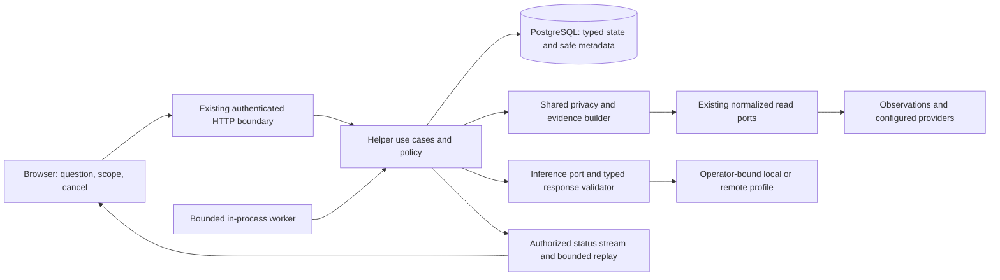

# Stackplore 2.0 proposed roadmap

Status: **implementation authorized, 2026-10-19**. Stage 0 design is accepted in ADRs 0014–0016; runtime stages are not delivered. Follow the [active evidence ledger](v2/implementation.md) for actual status. The initial proposal below does not establish runtime acceptance.
[Persian counterpart](roadmap-v2.fa.md).
Product baseline: published **1.0.3**, PostgreSQL schema **17**, immutable source `656581cf05d4774358d5644a6e1af3c69a210f81`.
The later documentation handoff is `c018cf09c20456d27dfa6daa3f74e342fe46e27e`; it is not a different release binary.
Keep [1.0.3 acceptance](evidence/1.0.3/published-release.json), the [completed v1 roadmap](roadmap.md), and [v1 specification](../SPEC.md) intact.

## Outcome and scope

Deliver a user-triggered, evidence-grounded troubleshooting helper. Explain observed infrastructure, investigate a selected problem, cite facts, state gaps, and suggest safe next checks.
All helper infrastructure access stays read-only in 2.0. No background autonomous investigations, scheduled actions, shell, exec, arbitrary provider proxy, Secret values, arbitrary network fetch, or browser-supplied endpoint or host path. Existing v1 guarded operations retain their separate contract.
Keep v1 exploration usable when the optional helper is disabled, slow, unavailable, or out of quota. Disable the new feature and external transmission by default. Public guest mode does not call a paid or external service.
Version 2.0 is complete only after stage 10. Optional guarded-action proposals belong to a later 2.1 scope and do not block 2.0.
Durations remain estimates. Stage 0 decisions freeze design limits; measured evidence remains necessary before a release claim. Paths and package names become canonical only with their owning implementation stage.

## Architecture and existing seams

Keep one modular Go service, React with strict TypeScript, shared interface components, the existing motion system, and PostgreSQL. A new process, queue server, vector database, or orchestration framework requires measured need and an accepted decision.

- Dependency direction stays transport/jobs → use cases → domain ports ← provider and PostgreSQL adapters. No provider SDK value crosses the domain or HTTP boundary.
- Reuse `domain.ObservationReader` in [observation_ports.go](../apps/api/internal/domain/observation_ports.go) for normalized inventory, topology, health, metrics, events, capabilities, and observation state. Logs use the separate [read port](../apps/api/internal/domain/provider_ports.go).
- Reuse existing auth, CSRF, origin checks, rate limits, recent-auth patterns, bounded PostgreSQL transactions, and migration locking. Follow [backend boundaries](architecture.md#backend-boundaries) and [HTTP authentication](architecture.md#http-and-authentication).
- Proposed packages: `internal/assistant` for use cases and runs; `internal/assistantpolicy` for authorization and budgets; `internal/contextbuilder` for safe evidence; `internal/inference` for the neutral port; dedicated inference adapters and `internal/postgres/assistant_*` repositories.
- Compose the runtime under [cmd/server](../apps/api/cmd/server/main.go). Reuse service ownership-loss and shutdown cancellation. New migrations extend schema 17; they do not alter recorded migration history.
- Keep additive HTTP resources under `/api/v1/assistant` and `/api/v1/analysis`. Product major version 2 does not itself require a new HTTP major version. Extend [OpenAPI](../contracts/openapi.yaml), regenerate transport types, and reject drift in the same implementation change.
- V1 administrator and viewer roles are installation-wide. A selected source or environment narrows a query; it does not create a new access boundary. Owner-private conversations do not imply per-source or tenant isolation.

## Data, authority, and network policy

Before any tool uses logs, move the effective limits and added redaction fields from [configured_logs.go](../apps/api/internal/httpapi/configured_logs.go) into a shared use-case policy. Direct provider access must not bypass that policy. Use structural allowlists and data minimization before masking patterns; patterns do not prove arbitrary text contains no secret.
Local free-form questions are bounded and private. Remote execution accepts approved structured question templates and selected safe fields by default. Free-form questions, raw log bodies, and arbitrary retrieved text cannot leave the installation in the default 2.0 policy. Broader text transmission needs an accepted privacy decision, explicit operator enablement, reviewed field inventory, and real transmission tests.
Passwords, raw tokens, session identifiers, provider credentials, private keys, kubeconfig content, Secret values, and full notification targets never enter helper context, helper storage, telemetry, responses, or test fixtures. Reject such input safely where identified; do not advertise universal secret detection.
Local and remote profiles are bound by the operator to exact approved endpoints and credential references. The browser selects only a safe profile identifier. Local profiles may use explicitly approved internal addresses; remote profiles use a separate strict egress policy. Neither changes [notification outbound guards](../apps/api/internal/notification/outbound.go).
Each connection attempt must enforce scheme, exact host/port, DNS address validation and pinning, TLS identity, redirect rejection, timeout, response size, and proxy policy. A prompt or tool result cannot select a host, path, DNS resolver, credential, or network client.
Local endpoints outside loopback require verified TLS; explicit loopback-only local profiles may use HTTP. Deny metadata endpoints, link-local and multicast addresses in every profile; an internal profile is not unrestricted private-network access. Review remote retention, training-use, regional processing and deletion terms before enabling a profile. Application controls do not establish control over the provider's storage.
Validate all tool arguments against closed schemas and current authority. Treat resource names, annotations, events, logs, runbooks, user input, and returned text as untrusted data. Instructions embedded in evidence cannot change policy or tool permissions.
Recheck user/session/auth revision, source configuration and provider authority before every step, publication, and replay. A source denial or restore-generation change fences old results and queued frames before cancellation. Already transmitted bytes cannot be recalled.
Do not cache private API responses, streams, or helper content in the service worker or offline application cache. Session changes clear any remaining owner-bound in-memory view state.

## Durable runtime and volatile text

PostgreSQL stores typed goals, owner identifiers, scope, policy/profile versions, run and step states, evidence references, event sequence numbers, budget reservations, and safe audit metadata. It does not persist raw prompts, log bodies, tool payloads, inference responses, or conversation text by default.
Question text and working context stay in bounded process memory. The proposed lifetime is 30 minutes or eight turns, whichever comes first. Expiry, restart, restore, or ownership loss discards them. A free-form run that loses required text becomes interrupted and needs user re-entry; safe status metadata may remain, but the worker must not invent or silently reconstruct missing text. A queued typed recipe may resume only after fresh actor, policy, authority, and remaining-budget checks; an uncertain inference dispatch never resumes automatically.
Use explicit queued, running, completed, failed, cancelled, expired, interrupted, and uncertain outcomes. Persist transitions atomically with version checks, lease owner, lease expiry, attempt number, and fencing generation. Never hold a database transaction across inference or provider I/O.
Claim bounded batches with short transactions and fair admission. The [notification lease implementation](../apps/api/internal/postgres/notification_delivery.go) offers a pattern; use separate helper tables and repository methods. Late workers cannot complete a replaced lease. Do not claim exactly-once external calls.
Reserve capacity and usage atomically before admission or dispatch. Bind idempotency to actor, conversation, typed goal, scope, profile, and material parameters. A matching retry returns the existing run; a changed fingerprint conflicts.
After an uncertain or partial inference request, stop automatic retry. For a potentially charged request, preserve an unknown-charge reservation. Reconcile only through supported provider usage evidence or an explicit operator process. Unknown usage is not zero and is not automatically refunded. A user-authorized new attempt creates a new run and reservation; retrying the original idempotent POST returns its existing run and does not resend the call.
Unknown-charge reservations are exempt from the seven-day conversation metadata expiry. Keep a minimal safe ledger or tombstone until reconciled or conservatively settled by an explicit audited operator process. Retention, quota resets, and restore must not release an unknown reservation or create a fresh spending allowance from it.
An older backup may omit later paid dispatches. After restore, keep paid admission disabled until the operator reconciles the affected usage interval or conservatively reserves its maximum exposure under the new restore generation. Restoring an old balance is not proof of unused quota.
Closing a browser stream does not cancel a run. Explicit cancellation persists intent, cancels bounded work, and rejects late output. Reconnect reads authorized status. Reuse the [transient stream hub](../apps/api/internal/realtime/hub.go) only for bounded fan-out; durable typed status is the replay authority.
Emit validated answer sections and status updates, not raw token streams. Server-assigned evidence IDs resolve only to permitted in-product views. Reject fabricated citation IDs, arbitrary links, images, active markup, and output-supplied actions.
Record model/profile identifier, revision when available, prompt-template version, policy version, input/output counts, duration, and outcome as safe metadata. Do not log text to make a failed run easier to debug.
Delete helper metadata only through its bounded lifecycle. Deleting a conversation or run cannot cascade into protected audit history. Application deletion does not erase existing backups or PostgreSQL write-ahead logs; document their separate retention and restore behavior.

## Proposed starting limits

These are design caps, not measured capacity or a service guarantee. Enforce the stricter existing policy when limits overlap. Stage 0 must verify counters and stage 9 must measure realistic profiles.

| Resource         | Proposed bound                                                                   |
| ---------------- | -------------------------------------------------------------------------------- |
| Running work     | One active run per user; two across the installation                             |
| Waiting work     | 16 total; at most two queued runs per user                                       |
| Run and calls    | 120 seconds per run; at most three inference calls, 25 seconds each              |
| Tools            | At most 12 calls; at most two parallel reads; fixed server allowlist             |
| Context          | At most 64 KiB decoded text and 16,000 input tokens; both apply                  |
| Generated output | At most 4,096 tokens and 64 KiB decoded output; both apply                       |
| Streaming        | At most 16 KiB per validated frame, within the existing v1 frame cap             |
| Durable metadata | Seven days; authorized status replay at most 24 hours                            |
| Volatile context | 30 minutes or eight turns, whichever comes first                                 |
| Local log opt-in | At most 200 lines, 32 KiB, and a 15-minute window; tighter v1 limits still apply |

Use verified profile-specific token counters. If the required token bound cannot be checked, reject dispatch; the byte cap remains an independent hard limit. Never label a byte estimate as verified token usage.
Add per-user and installation usage quotas, call reservations, queue fairness, and a global kill switch. Stage 0 defines cost units and any currency ceiling from the selected profile's real terms. No fixed vendor, price, hardware, or throughput is assumed here.

## Delivery stages

Each stage ships only after its dependencies and exit tests pass. Before a checkpoint: update the English/Persian documents, add focused tests, run the full local gate, inspect the reviewed diff, then commit and push an authorized implementation milestone. Inspect exact-source hosted results. A failed gate remains recorded and blocks the next checkpoint.
Prerelease labels below are intended names. Current version and release parsers accept prerelease syntax. Stage 0 must preserve that behavior and prove the full Helm/OCI, archive, tag, checksum/provenance, publication, and independent-consumer paths before the first checkpoint. Syntax support alone does not prove those bindings. Never weaken existing checks to accept a new suffix.

### Stage 0 — Scope, decisions, and baseline — 3–5 person-days

- **Dependencies:** Published 1.0.3 proof and the current source review. The maintainer's implementation instruction adds the versioned `2.0.0-alpha.0` checkpoint; its own gates must pass before tagging.
- **Features and architecture:** Accept the 2.0 boundary, user journeys, role matrix, data inventory, capability map, state machine, profile selection, budget plan, and evaluation design. Decide local hardware requirements and remote terms from current official sources. Create proposed decisions, then obtain acceptance before relying on them.
- **Security:** Model trust boundaries, indirect instruction attacks, data transmission, hostile output, overbroad tools, resource abuse, revocation, backup retention, and uncertain charges. Resolve privacy defaults before external testing.
- **Tests:** Capture the unchanged v1 local, browser, database, deployment, and workload baselines. Design negative fixtures and evaluation splits. Add prerelease parser fixtures before the first prerelease.
- **Exit:** Decisions accepted; measurable acceptance matrix and baseline receipts exist; unsupported assumptions have owners. No runtime capability is called shipped.
- **Documents:** Product addendum, accepted decisions, threat model, permission and data-flow tables, evaluation protocol, profile comparison, effort revision, and prerelease compatibility report.

### Stage 1 — Operator-bound inference gateway — 4–7 person-days — `2.0.0-alpha.1`

- **Dependencies:** Stage 0. Keep user-facing dispatch disabled until durable admission and shared privacy are ready.
- **Features and architecture:** Implement the neutral port, closed request/result schemas, cancellation, profile validation, safe credentials references, capability checks, and deterministic test adapter. Prove one chosen local profile; make a remote profile optional under its approved policy.
- **Security:** Enforce endpoint binding, TLS, DNS pinning, redirects, credentials lifetime, bounded decoding, no ambient proxy, and no browser endpoint input. Remote testing uses synthetic safe fields.
- **Tests:** Fake and real adapter contract tests; malformed/truncated/oversized responses; unsupported features; timeout/cancel; DNS changes; TLS mismatch; redirect and private-address denial according to profile; secret-free errors. Run paid integration checks only in protected jobs with synthetic inputs and a hard budget cap; untrusted pull requests receive no integration credentials.
- **Exit:** A disposable real profile completes a typed request; all negative boundaries pass; v1 works with the gateway absent or failing.
- **Documents:** Gateway contract, operator profile setup, credential rotation, error codes, trust roots, capability limitations, and exact integration receipt.

### Stage 2 — Durable admission and run runtime — 6–10 person-days — `2.0.0-alpha.2`

- **Dependencies:** Stage 1. No raw text persistence or public tool dispatch.
- **Features and architecture:** Add migrations, typed runs/steps/events, owner-private metadata, bounded worker, leases/fencing, cancellation, idempotency, usage reservations, fair queue, status replay, retention, and shutdown integration.
- **Security:** Session and role revalidation, safe audit lifecycle, per-user admission, unknown-charge handling, restore-generation invalidation, and fail-closed database errors. An expired or lost volatile question cannot resume by itself.
- **Tests:** Real PostgreSQL migration from schema 17; competing claimers; stale completion; crash before/after dispatch and commit; duplicate request; changed fingerprint; cancel/revoke/restart/restore; quota races; retention bounds; backup/restore. Test unknown-charge retention, quota reset, and concurrent reconciliation against real PostgreSQL. Run concurrency detection.
- **Exit:** Deterministic state-transition tests pass; no duplicated accepted result or unaccounted reservation; no automatic retry of uncertain paid work; owned test resources are cleaned.
- **Documents:** State machine, schema and repository contract, usage reconciliation, restart/restore behavior, cleanup lifecycle, and native recovery receipt.

### Stage 3 — Shared privacy and evidence builder — 5–8 person-days — `2.0.0-alpha.3`

- **Dependencies:** Stage 2; this stage gates every production read tool.
- **Features and architecture:** Extract shared effective log policy. Build bounded typed evidence from inventory, health, metrics and events with source/time/version/completeness. Add server-issued references and a separate local log opt-in. Remote context stays approved structured fields only.
- **Security:** Enforce field allowlists before context and egress. Keep raw data and text volatile. Recheck source and observation authority; distinguish stale/partial/denied/synthetic evidence. A reference does not grant access after revocation or retention.
- **Tests:** Added operator redaction applies outside HTTP; poison names/annotations/logs; deny and source-disable races; stale and partial data; future/shifted clocks; resource replacement; missing metrics; byte/page limits; wire capture proves blocked fields never leave.
- **Exit:** Every tool result passes the shared policy; citation resolution is authorized; remote raw question/log transmission is rejected; no raw payload is found in database or telemetry fixtures.
- **Documents:** Field inventory, egress matrix, context schema, citation lifecycle, local log consent, privacy limits, and transmission evidence.

### Stage 4 — Bilingual grounded conversation — 5–8 person-days — `2.0.0-alpha.4`

- **Dependencies:** Stage 3. Initially use one bounded evidence request and answer; no open-ended loop.
- **Features and architecture:** Add the Smart Assistant view, selected source/time scope, approved remote templates, bounded local questions, grounded sections, visible evidence links, gaps, cancel/retry/status, and volatile turn history. Use English and Persian, technical LTR isolation, keyboard support, and reduced motion.
- **Security:** Treat returned text as untrusted display data. Validate complete sections before rendering. Keep conversation owner checks on every route and stream. Remote templates never accept hidden free-form interpolation.
- **Tests:** Real browser locale/RTL/mobile/keyboard/accessibility checks; malformed output; fabricated citations; dangerous markup/links/images; turn expiry; logout/account change; reconnect/overflow/reset; profile outage; empty and permission-denied evidence.
- **Exit:** Both languages complete the same grounded journey; raw streams and unsafe output never render; expired text asks for re-entry; the existing exploration interface stays usable.
- **Documents:** User guide, privacy notices, accessible states, locale checklist, API and generated type changes, browser receipts, and known limitations.

### Stage 5 — Bounded read-only investigation loop — 6–10 person-days — `2.0.0-alpha.5`

- **Dependencies:** Stage 4. User-triggered runs only.
- **Features and architecture:** Add plan → validated read → evidence → bounded answer. Tools cover narrow inventory, health, topology, metrics, events, and locally opted-in logs. All arguments are typed. Stop on enough evidence, missing authority, cancellation, budget, or an unsupported need.
- **Security:** Instructions in retrieved data cannot alter the tool allowlist, source scope, quotas, endpoint, or goal. No SQL, shell, arbitrary files, provider write ports, or unbounded recursive planning. Reserve each call before dispatch.
- **Tests:** Hostile tool results; fabricated tool names; cross-scope IDs; loops; repeated pages; conflicting evidence; concurrent reads; exact caps; budget exhaustion; unknown-charge retry denial; source revocation during a step; no late frames after fencing.
- **Exit:** Every step is bounded, authorized, and attributable to evidence; injected instructions cannot trigger extra access; cancellation and uncertain billing behave as specified.
- **Documents:** Tool catalog and schemas, stop rules, policy tests, budget examples, cancellation protocol, and integration receipts.

### Stage 6 — Smart Analysis incident workflows — 6–10 person-days — `2.0.0-alpha.6`

- **Dependencies:** Stage 5. All diagnoses remain suggestions.
- **Features and architecture:** Add selected-resource incident timelines, symptom summaries, ranked and qualified hypotheses, contrary evidence, data gaps, safe next reads, and a concise incident report. Correlate existing alerts, workload history, events, health and metrics. Correlation is not proof of cause.
- **Security:** No action buttons derived directly from generated output. A hypothesis cannot override an unavailable/denied status. Keep event/log instructions inert and remote field policy unchanged.
- **Tests:** Docker, Kubernetes and Demo cases for restart/OOM symptoms, failed workloads, capacity pressure, connectivity, missing metrics, misleading chronology, multiple causes, and insufficient evidence. Validate every cited fact and expected abstention in both languages.
- **Exit:** A held-out incident evaluation meets the shared quality gates; novel hypotheses are marked as hypotheses; reports expose scope, time, freshness, missing evidence, and safe next steps.
- **Documents:** Incident workflow guide, failure taxonomy, annotated evaluation examples, quality report, and report/retention behavior.
- **Sources:** [OWASP prompt injection](https://genai.owasp.org/llmrisk/llm01-prompt-injection/) and [excessive agency](https://genai.owasp.org/llmrisk/llm062025-excessive-agency/) support untrusted-input and least-authority principles. The [NIST risk profile](https://www.nist.gov/publications/artificial-intelligence-risk-management-framework-generative-artificial-intelligence) supports lifecycle risk review. These references do not prescribe this roadmap's numerical gates or certify the product.

### Stage 7 — Curated runbooks and metadata history — 4–7 person-days — `2.0.0-alpha.7`

- **Dependencies:** Stage 6. Content remains subject to the same privacy and authority policy.
- **Features and architecture:** Add an operator-approved inert runbook corpus, versioned document IDs, PostgreSQL full-text search, bounded snippets, and evidence-linked metadata history. No embeddings are required. History shows safe run scope, status, timing and references; expired conversation text is not recreated.
- **Security:** Only the operator can approve or replace corpus versions. No browser host path, arbitrary URL crawler, executable content, remote retrieval shortcut, or automatic learning from user conversations. Do not export corpus text remotely under the default structured-only policy.
- **Tests:** Unapproved and removed documents; poisoned instructions; locale search; bounded import/search; stale references; cross-owner history; corpus deletion/retention; restore invalidation; privacy checks on derived indexes and backup copies.
- **Exit:** Retrieval uses only approved versions; citations identify document version; deletion and expiry are truthful; no newly introduced external store is required.
- **Documents:** Corpus format and review process, import/rollback procedure, search limitations, history policy, retention/backup deletion semantics, and SQL query plans.

### Stage 8 — Security, quality, and failure hardening — 6–10 person-days — `2.0.0-alpha.8`

- **Dependencies:** Stage 7. Security tests from earlier stages remain mandatory throughout development.
- **Features and architecture:** Complete the adversarial suite, release evaluation harness, safe telemetry, usage reconciliation, fault injection, profiling, and hot-path query review. Keep reproducible fixtures and report exact profile versions.
- **Security:** Review every trust boundary and attempt tool escalation, instruction injection, data exfiltration, role/replay bypass, malicious output, quota abuse, and archive/restore leakage. Resolve all critical failures before beta.
- **Tests:** Run the quality protocol below, real PostgreSQL failures and restarts, adapter outages and malformed streams, concurrency detection, slow clients, retention, and ownership loss. Do not weaken existing coverage or workload gates.
- **Exit:** All security-critical cases pass; quality and runtime thresholds pass per supported profile; unresolved noncritical risks have explicit scope, owners, and release decisions. Before beta, approve each profile's absolute RAM limit and measured latency/cost baseline on named hardware.
- **Documents:** Threat-model revision, red-team results, quality and performance reports, measured limits, telemetry inventory, and open-risk register.

### Stage 9 — Beta pilot, upgrade, and deployment — 5–8 person-days — `2.0.0-beta.1`

- **Dependencies:** Stage 8. Operator opts into a controlled pilot; customer deployment needs its own authorization and proof.
- **Features and architecture:** Prove native, Compose and Helm setup with the feature off and on; supported local/remote profiles; quotas and kill switch; upgrade from 1.0.3; PostgreSQL backup and restore. Rehearse rollback through a verified pre-upgrade backup if schema compatibility is absent.
- **Security:** Verify least provider rights stay unchanged, credentials are not baked into artifacts, remote mode stays opt-in, network policy matches the chosen profile, and disabled mode transmits nothing.
- **Tests:** Real installation/API probes and full user journeys; upgrade interrupted at each boundary; unavailable profile startup; restore/auth invalidation; empty/expired corpus; workload regression, 60-minute soak, and 100 cancel/reconnect/restart cycles.
- **Exit:** Pilot acceptance and all installation receipts pass with named hardware, profile, limits, and remaining operational responsibilities. A green HTTP response alone is not product acceptance.
- **Documents:** English/Persian setup, upgrade and recovery guides; profile runbooks; monitoring and incident response; compatibility matrix; pilot findings and capacity receipts.

### Stage 10 — Release candidate and independent stable acceptance — 3–5 person-days — `2.0.0-rc.1` → `2.0.0`

- **Dependencies:** Stage 9 and a complete acceptance matrix. Any candidate fix repeats the affected gates and full release gate.
- **Features and architecture:** Freeze the supported scope, contracts, migrations, default limits, profile versions, and operator obligations. Build the candidate, then build and accept the actual stable artifacts independently.
- **Security:** Complete dependency/license/vulnerability review, artifact provenance and checksum checks, default-off verification, credential handling, and final threat-model review. Preserve failed attempts and immutable tags.
- **Tests:** Full local gate, all seven exact-source hosted jobs, actual database/container/browser/provider checks, signed package validation, and independent native/database recovery on downloaded stable assets. Build stable source and packages with their own receipts; do not relabel candidate evidence as stable proof.
- **Exit:** Every 2.0 acceptance row has a passing receipt tied to source and artifacts; no critical issue remains; public release, tags, documents and limitations agree. The final documentation commit passes its own seven-job hosted gate. Unsupported platforms or customer capacity remain explicitly unproven.
- **Documents:** Final specification and decisions, architecture/security guides, OpenAPI/types, configuration, user/operations guides in both languages, changelog, migration notes, release checklist, support matrix, and immutable acceptance index.

## Quality and operational acceptance protocol

- Build **200 paired English/Persian scenarios**, producing **400 prompts**, covering each supported infrastructure provider, quality state, and workflow. Split by underlying cause family into 60% development, 20% validation, and 20% held-out test; paired translations stay in the same split. Prevent near-duplicate incident or runbook leakage.
- Add at least **1,000 adversarial cases** across direct and retrieved instructions, exfiltration, malformed tool/output schemas, authorization/replay, quotas, and network policy. Run three independent held-out passes for every supported inference profile and record profile revisions/settings.
- Require **100% structurally valid and authorized citation IDs**, **at least 95% human-verified factual grounding**, and **at least 95% correct abstention** for insufficient/denied evidence, reported separately for each language and infrastructure provider. Novel hypotheses must be qualified and grounded, not counted as observed facts. Freeze scoring rubrics before held-out runs.
- Require **100% of security-critical cases** to pass. Human-review a stratified 20% of outputs plus every critical case, disagreement, and suspected unsupported claim. Use a distinct reviewer and resolve disagreements. Report exact denominators, failures, confidence intervals, and sampled-versus-complete scoring; thresholds are acceptance proposals, not universal guarantees.
- Maintain existing coverage floors and require at least **90% branch coverage** on new policy/runtime packages. Test behavior and failure boundaries, not only implementation-shaped mocks. Real PostgreSQL, adapter, browser, container, Docker and Kubernetes claims need their own receipts.
- In the unchanged v1 workload fixture—80 reads, eight parallel requests, ten rounds and minimum 600 ms spacing—require no more than **10% p95 regression** against the same-source baseline on the same hardware, alongside the existing absolute limits. Measure with helper load enabled and disabled; report queues, memory, database waits, and errors. Before beta, set an absolute RAM bound and record latency/cost baselines separately for each supported profile.
- Target cancellation within **two seconds after an explicit local cancellation or observed revocation**, including fenced publication and owned task cleanup. Do not claim two seconds from an unobserved provider permission change. Preserve the existing limitation for bytes already written to the network.
- Complete a **60-minute soak** plus **100 lifecycle cycles** with no orphan worker, subscription, accepted late result, or unbounded queue/context growth. Show bounded retention and reservations, including unknown charges. Customer-scale capacity requires a separate measured workload.

## Later 2.1 option: proposal handoff only

An optional later stage may turn a qualified recommendation into a typed draft for the existing restart/scale preview. It does not execute autonomously, expand the action allowlist, or form part of 2.0 completion.
Use the existing [guarded operation service](../apps/api/internal/operation/service.go) and [operation domain](../apps/api/internal/domain/operation.go), with all gates preserved: deployment enablement; separate provider write permission; administrator; CSRF; recent purpose-bound authentication; exact target/current version/capability; server allowlist; impact preview; one-use actor/target/parameter-bound confirmation; idempotency; durable audit intent; bounded provider call and result audit. Guest mode stays forbidden.
The human initiates and confirms through the existing flow. Recheck versions after proposal creation. An uncertain write is never automatically repeated; preserve [orphan recovery semantics](../apps/api/internal/postgres/operation_recovery.go). Undo requires a new supported action and new gates; automatic rollback is not promised.

## Effort, evidence, and review loop

The stages total **53–88 person-days** before contingency. With about 25% contingency and five working days per week, plan roughly **14–22 weeks** for one developer with scheduled security/product/operations review. This is an estimate, not a delivery date; stage 0 must rebase it for hardware, profile rights, evaluation cost, and reviewer availability.
Stages are ordered by dependency. Dataset preparation and documentation can overlap; integration must not skip the shared privacy, durable runtime, and authority gates. Give each acceptance item an owner, command or procedure, exact source, result, artifact reference, and unresolved limit.
At every stage: score architecture and code honestly, list remaining defects, fix them, and repeat review until at least 9/10 within the declared scope. A score is not a substitute for receipts, and an accepted stage does not pre-certify later code.
Follow [testing](testing.md#safety-and-review), [release rules](releasing.md#final-10-scope-and-corrective-103-gate), [security boundaries](security.md#trust-boundaries), and [deployment operations](operations/deployment.md). Keep v1 acceptance immutable; store new stage proof separately and never describe this proposal as delivered behavior.

## Historical proposal-only review receipt — 2026-10-19

Document review: **9/10**, after route/state/guest/network/cancellation parity and unknown-charge retention/restore fixes. This score applies to the plan, not unbuilt runtime behavior.
With the pinned repository tools, `& .\.tools\node-v24.18.0-win-x64\node.exe scripts/check-docs.mjs` passes the inventory and **1,020 local links**; `& .\.tools\node-v24.18.0-win-x64\node.exe scripts/check-version.mjs` confirms **1.0.3**; `git diff --check` passes. Explicit formatting checks on the five changed documents pass.
No runtime files, migrations, accepted decisions, contracts or release versions changed. Runtime tests were not run for this documentation-only proposal; no 2.0 behavior is proven by these checks.
